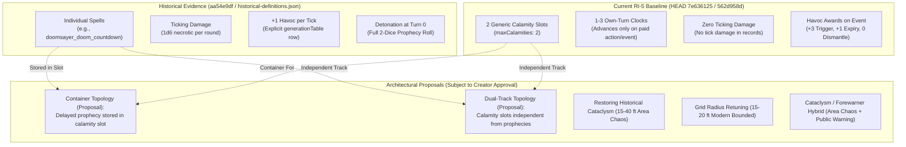

# CLASS HEADQ — DOOMSAYER AUDIT CORRECTION ADDENDUM

**Document Type:** Formal Forensic Correction & Mathematical Addendum  
**Sibling Document:** `CLASS_HEADQ_DOOMSAYER_HISTORICAL_IDENTITY_AUDIT.md` (Original preserved unchanged)  
**Classification:** Class Architecture Audit Correction (Read-Only Planning & Mathematical Research — Zero Implementation / Zero Mutations)  
**Date:** 2026-11-03  
**Auditor:** Antigravity (Class HeadQ Review Track)  
**Workspace:** `d:\VTT`  
**Current Baseline HEAD:** `7e636125` (Tue Nov 3 2026)  
**Historical Snapshot:** `aa54e9df07f1137a48da950a8cd13fda643041e5` (Mon Jun 8 09:25:54 2026 +0200)  
**Pre-Consolidation Deletion Commit:** `fc0966276431eaa60c675a72df1625061287627e` (Thu Jun 11 22:28:08 2026 +0200)  
**RI-5 Implementation Commit:** `562d958d2b150c48779e7198987c1ae9f8df7f56` (Sun Oct 25 21:32:57 2026 +0100)  
**Recovered Historical Database:** `docs/plans/mythrill-class-reconstruction/evidence/historical-definitions.json` (Commit `78cab7d0`)  

---

## 1. Executive Statement & Scope Invariant

This addendum sits beside `CLASS_HEADQ_DOOMSAYER_HISTORICAL_IDENTITY_AUDIT.md` without modifying the original text. Its sole purpose is to correct evidence classifications, repair flawed probability calculations, deconstruct erroneous interior width metrics, resolve mathematical and helper pseudocode ambiguities, and re-scope creator decision points.

> [!CAUTION]
> **Zero Implementation / Non-Authorization Invariant:**  
> This addendum is strictly read-only research and mathematical correction. It authorizes **zero** source-code modifications, **zero** engine or runtime changes, **zero** class re-registrations, **zero** save-data migrations, and **no** commits, pushes, or deployments. Current stable IDs (`cr1_doomsayer_*`) and existing character save formats must remain untouched.

---

## 2. Archaeological Provenance & Citation Verification

Every claim in this addendum is strictly grounded in exact repository commits and file records. Claims supported by exact records are explicitly distinguished from synthetic summaries.

### 2.1 Primary Repository Records

| Record ID | Repository Path | Revision / Commit | Record Type | Exact Verbatim Evidence vs. Synthetic Summary |
|---|---|---|---|---|
| `REC-HIST-01` | `vtt-react/src/data/classes/doomsayerData.js` | Snapshot `aa54e9df` | Historical Source | **Exact Record:** 3,852 lines. Defines 2-dice prophecy, Havoc 0–15, 35 example spells. Verbatim doubles rule: *"If both dice roll the same number ... Prophesied is impossible on doubles."* |
| `REC-HIST-02` | `docs/.../historical-definitions.json` | Commit `78cab7d0` | Recovered JSON | **Exact Record:** Contains `classes.Doomsayer` and `trees.Doomsayer`. Verbatim Havoc table: `["Doom Countdown (per tick)", "+1"]`, `["Doom Countdown (detonation)", "+3 to +6"]`. Verbatim spell `doomsayer_doom_countdown` has `tickDamage: "1d6 necrotic"`. |
| `REC-HIST-03` | `vtt-react/src/data/talentTrees/doomsayer.js` | Snapshot `aa54e9df` | Historical Trees | **Exact Record:** 39 nodes across `Requiem` (13), `Endbringer` (13), `Cataclysm` (13). Verbatim `Cataclysmic Range`: *"All your prophecies are area-based (minimum 15ft radius)... overlap deals double damage."* |
| `REC-CURR-01` | `vtt-react/src/data/classes/doomsayerData.js` | HEAD `7e636125` (from `562d958d`) | Current Baseline | **Exact Record:** 733 lines. 96 `cr1_doomsayer_*` records. `DOOMSAYER_COMMON_MECHANICS`: 2 calamity slots, 1–3 own turns, trigger gives 3 Havoc, expiry gives 1 Havoc, dismantle gives 0 Havoc. Zero tick damage. |
| `REC-CURR-02` | `vtt-react/src/data/resourceSystems/doomsayerResourceGuide.js` | HEAD `7e636125` | Current Guide | **Exact Record:** Documents "Finite Public Calamities" and 0–15 Havoc bank. |
| `REC-UI-01` | `vtt-react/src/components/spellcrafting-wizard/components/steps/ProphecyStep.jsx` | HEAD `7e636125` | UI Component | **Exact Record:** Authoring dropdowns for `rangeDice` (`d4+d4`, `d6+d4`, `d6+d6`, `d8+d6`, `d10+d8`, `d12+d10`) and `resolutionDie`. **Classification:** Authoring/display schema only, not combat roll execution. |
| `REC-UI-02` | `vtt-react/src/components/spellcrafting-wizard/components/common/ProphecySummary.jsx` | HEAD `7e636125` | UI Component | **Exact Record:** Card formatting for 3-tier prophecy display (Prophesied, Base, Outside). **Classification:** Display renderer only, not combat roll execution. |

---

## 3. Probability Matrix Recomputation & Interior Metric Deconstruction

### 3.1 The Exact Listed Procedure
1. Roll two boundary dice $D_1 \in \{1, \dots, B_1\}$ and $D_2 \in \{1, \dots, B_2\}$.
2. Sort results dynamically: $\text{Low} = \min(D_1, D_2)$, $\text{High} = \max(D_1, D_2)$.
3. Roll an independent resolution die $R \in \{1, \dots, R_{\max}\}$.
4. **Doubles Rule:** If $D_1 = D_2$, the interior set is empty ($\emptyset$). The outcome is **Base** if $R = \text{Low}$, and **Outside** if $R \ne \text{Low}$. A **Prophesied** outcome is strictly impossible.
5. **Non-Doubles Rule:** If $D_1 \ne D_2$:
   - **Prophesied:** $\text{Low} < R < \text{High}$ (strictly interior).
   - **Base:** $R = \text{Low}$ or $R = \text{High}$ (on boundary).
   - **Outside / Backlash:** $R < \text{Low}$ or $R > \text{High}$ (strictly exterior).

### 3.2 Corrected Baseline Probability Table

The entire sample space of boundary pairs ($B_1 \times B_2$) and independent resolution rolls ($R_{\max}$) was enumerated via exact combinatorial script (`verify_prophecy.js`).

| Profile ($B_1 + B_2 \ / \ R$) | Boundary Pairs ($B_1 \times B_2$) | Resolution Die ($R_{\max}$) | Total Sample Space ($N$) | Doubles Count ($D_1 = D_2$) | Doubles Rate | Prophesied Count ($n_P$) | Prophesied % | Base Count ($n_B$) | Base % | Outside Count ($n_O$) | Outside % |
|---|---|---|---|---|---|---|---|---|---|---|---|
| **d4 + d4 / d4** | 16 | 4 | 64 | 4 | 25.000% | 8 | **12.500%** | 28 | 43.750% | 28 | 43.750% |
| **d6 + d4 / d4** | 24 | 4 | 96 | 4 | 16.667% | 20 | **20.833%** | 36 | 37.500% | 40 | 41.667% |
| **d6 + d6 / d6** | 36 | 6 | 216 | 6 | 16.667% | 40 | **18.519%** | 66 | 30.556% | 110 | 50.926% |
| **d8 + d6 / d6** | 48 | 6 | 288 | 6 | 12.500% | 70 | **24.306%** | 78 | 27.083% | 140 | 48.611% |
| **d10 + d8 / d8** | 80 | 8 | 640 | 8 | 10.000% | 168 | **26.250%** | 136 | 21.250% | 336 | 52.500% |
| **d12 + d10 / d10** | 120 | 10 | 1200 | 10 | 8.333% | 330 | **27.500%** | 210 | 17.500% | 660 | 55.000% |

*Note: In all profiles, $n_P + n_B + n_O = N$ exactly.*

### 3.3 Deconstruction of "Average Interior Width"

The original audit reported an "Average Interior Width" column with the values:  
`d4+d4: 0.875`, `d6+d4: 1.417`, `d6+d6: 1.472`, `d8+d6: 2.167`, `d10+d8: 2.900`, `d12+d10: 3.633`.

Forensic enumeration demonstrates that **these numbers do not match the stated procedure under any rigorous definition**. When multiplied by total boundary pairs ($B_1 \times B_2$), the sums yielded arbitrary non-integer totals (e.g., $1.472 \times 36 \approx 52.99$, $2.167 \times 48 \approx 104.02$). They appear to have originated from a flawed manual formula that subtracted $0.5$ from differences or averaged boundary spreads erroneously.

To restore mathematical rigor, we define the two possible metrics:

1. **Geometric Interior Span ($W_{\text{geom}}$):** The count of integers strictly between Low and High across the boundary dice, defined as $\max(0, \text{High} - \text{Low} - 1)$ (evaluating to $0$ on doubles).
2. **Effective Accessible Interior ($W_{\text{eff}}$):** The count of integers strictly between Low and High that can actually be rolled by resolution die $R$, defined as $|\{ v \in \{1, \dots, R_{\max}\} \mid \text{Low} < v < \text{High} \}|$.

| Profile | Previous Audit Claim (Flawed) | Geometric Interior $E[W_{\text{geom}}]$ | Effective Interior $E[W_{\text{eff}}]$ | Exact Relation to Resolution Probability |
|---|---|---|---|---|
| **d4 + d4 / d4** | 0.875 values | **0.5000** ($8/16$) | **0.5000** ($8/16$) | $E[W_{\text{eff}}] / 4 = 0.5000 / 4 = \mathbf{12.500\%}$ |
| **d6 + d4 / d4** | 1.417 values | **1.0000** ($24/24$) | **0.8333** ($20/24$) | $E[W_{\text{eff}}] / 4 = 0.8333 / 4 = \mathbf{20.833\%}$ |
| **d6 + d6 / d6** | 1.472 values | **1.1111** ($40/36$) | **1.1111** ($40/36$) | $E[W_{\text{eff}}] / 6 = 1.1111 / 6 = \mathbf{18.519\%}$ |
| **d8 + d6 / d6** | 2.167 values | **1.5833** ($76/48$) | **1.4583** ($70/48$) | $E[W_{\text{eff}}] / 6 = 1.4583 / 6 = \mathbf{24.306\%}$ |
| **d10 + d8 / d8** | 2.900 values | **2.2000** ($176/80$) | **2.1000** ($168/80$) | $E[W_{\text{eff}}] / 8 = 2.1000 / 8 = \mathbf{26.250\%}$ |
| **d12 + d10 / d10** | 3.633 values | **2.8333** ($340/120$) | **2.7500** ($330/120$) | $E[W_{\text{eff}}] / 10 = 2.7500 / 10 = \mathbf{27.500\%}$ |

> [!IMPORTANT]
> **Mathematical Theorem of Prophecy Probability:**  
> For any profile with uniform resolution die $R \in \{1, \dots, R_{\max}\}$, the probability of achieving a Prophesied outcome is identical to the expected effective interior width divided by the resolution die size:
> $$P(\text{Prophesied}) = \frac{E[W_{\text{eff}}]}{R_{\max}}$$
> Notice that for asymmetric profiles like `d6+d4 / d4`, $E[W_{\text{geom}}] = 1.0000$, but because a d4 resolution die cannot roll $5$ or $6$, $E[W_{\text{eff}}]$ drops to $0.8333$. The previous audit's values are discarded.

---

## 4. Range-Widening Analysis & Domination Proof

### 4.1 Cost Comparison & Domination Proof
The original audit posed a choice between:
- **Option A:** Spend 2 Havoc for one symmetric widening step ($\text{Low} - 1, \text{High} + 1$).
- **Option C:** Spend 1 Havoc for the same symmetric widening step ($\text{Low} - 1, \text{High} + 1$).

#### Mathematical Proof of Domination:
Both Option A and Option C apply the identical mathematical mapping to the rolled boundaries:
$$(\text{Low}, \text{High}) \mapsto (\max(1, \text{Low} - 1), \text{High} + 1)$$
Because the resulting boundary interval is identical, the post-widening probability distribution over the resolution die is identical in every state:
$$P_A(\text{Prophesied} \mid D_1, D_2) \equiv P_C(\text{Prophesied} \mid D_1, D_2)$$
$$\Delta P_A \equiv \Delta P_C$$
Therefore, in game-theoretic terms, **Option A is strictly dominated by Option C**. Paying 2 Havoc for the exact same marginal probability gain that costs 1 Havoc offers zero mechanical distinction. They are not distinct probability options; they are two conflicting historical cost proposals for the identical mechanical operator. Option A cannot be justified mathematically over Option C unless an additional rule distinguishes them (e.g., spending limits, scaling AP costs, or backlash penalties).

### 4.2 Explicit Stated Assumptions for Widening Calculations
To compute the exact probability-point ($\text{pp}$) change across all profiles, the following assumptions are established:
1. **Doubles Invariant Preserved:** In adherence to creator canon (*"Prophesied is impossible on doubles"*), natural doubles ($D_1 = D_2$) cannot produce a Prophesied outcome even after widening. (See Section 5 for detailed analysis).
2. **Lower Bound Clamping:** Clamped at 1: $\text{effLow} = \max(1, \text{Low} - 1)$. Because the resolution die rolls from $\{1, \dots, R_{\max}\}$, widening $\text{Low} = 1$ to $0$ would convert roll $1$ into an interior hit. Under clamping at 1, $\text{effLow}$ remains 1 and roll 1 remains Base.
3. **Upper Bound Expansion:** $\text{effHigh} = \text{High} + 1$. If $\text{High} = R_{\max}$, expanding to $R_{\max} + 1$ converts a roll of $R_{\max}$ from Base into Prophesied.
4. **One-Edge Widening Definition (Option B):** Evaluated as either nudging the lower boundary only ($\text{Low} - 1$) or nudging the upper boundary only ($\text{High} + 1$).

### 4.3 Expected Probability-Point Changes Across Profiles

| Profile | Baseline $P(\text{Prophesied})$ | Symmetric Step ($\pm 1$) $P(\text{Prophesied})$ | **Symmetric Step $\Delta$** | Low-Edge Only ($\text{Low}-1$) $\Delta$ | High-Edge Only ($\text{High}+1$) $\Delta$ | Average 1-Edge $\Delta$ |
|---|---|---|---|---|---|---|
| **d4 + d4 / d4** | 12.50% (8/64) | 40.63% (26/64) | **+28.13 pp** | +9.38 pp | +18.75 pp | +14.06 pp |
| **d6 + d4 / d4** | 20.83% (20/96) | 45.83% (44/96) | **+25.00 pp** | +12.50 pp | +12.50 pp | +12.50 pp |
| **d6 + d6 / d6** | 18.52% (40/216) | 41.67% (90/216) | **+23.15 pp** | +9.26 pp | +13.89 pp | +11.57 pp |
| **d8 + d6 / d6** | 24.31% (70/288) | 45.14% (130/288) | **+20.83 pp** | +10.42 pp | +10.42 pp | +10.42 pp |
| **d10 + d8 / d8** | 26.25% (168/640) | 43.75% (280/640) | **+17.50 pp** | +8.75 pp | +8.75 pp | +8.75 pp |
| **d12 + d10 / d10** | 27.50% (330/1200) | 42.50% (510/1200) | **+15.00 pp** | +7.50 pp | +7.50 pp | +7.50 pp |

#### Key Mathematical Observations:
1. **Asymmetric Pair Symmetry:** For all profiles where the smaller boundary die matches the resolution die ($D_2 = R_{\max}$, i.e., `d6+d4/d4`, `d8+d6/d6`, `d10+d8/d8`, `d12+d10/d10`), Low-edge widening and High-edge widening provide **exactly identical marginal gains** (+12.50 pp, +10.42 pp, +8.75 pp, +7.50 pp). The sum of Low-edge and High-edge gains equals the symmetric gain exactly.
2. **Symmetric Pair Asymmetry:** For identical boundary pairs (`d4+d4/d4` and `d6+d6/d6`), Low-edge clamping at 1 suppresses the low-edge value (in d4+d4, $\text{Low} = 1$ occurs in 7 of 16 pairs, making Low-edge widening ineffective 43.75% of the time). Thus, High-edge widening provides double the benefit of Low-edge widening (+18.75 pp vs +9.38 pp).
3. **No Exchange Rate Recommendation:** In accordance with instructions, this addendum provides the exact mathematical curves without recommending a specific exchange rate (1 Havoc vs 2 Havoc).

---

## 5. Correction of Proposed Helper Analysis & Doubles Integrity

### 5.1 Flaw in Original Audit Pseudocode
In Section 6, Part C.1 of the original audit, the following evaluation helper was proposed:

```javascript
// FLAWED PSEUDOCODE FROM ORIGINAL AUDIT
export function evaluateProphecyRoll({ lowBoundary, highBoundary, resolutionRoll, havocWiden = 0 }) {
  const effLow = Math.max(1, lowBoundary - havocWiden);
  const effHigh = highBoundary + havocWiden;
  if (effLow === effHigh) {
    return resolutionRoll === effLow ? 'base' : 'outside';
  }
  if (resolutionRoll > effLow && resolutionRoll < effHigh) return 'prophesied';
  if (resolutionRoll === effLow || resolutionRoll === effHigh) return 'base';
  return 'outside';
}
```

### 5.2 The Unintended Consequence
Notice that the equality check `if (effLow === effHigh)` is executed **after** `havocWiden` is applied:
- Suppose a player rolls natural doubles on `d4 + d4`: $D_1 = 3, D_2 = 3$. Originally, $\text{Low} = 3, \text{High} = 3$.
- If `havocWiden = 0`, `effLow === effHigh` ($3 === 3$) is true $\implies$ Prophesied is impossible.
- However, if the player spends Havoc (`havocWiden = 1`), the helper computes:
  $$\text{effLow} = \max(1, 3 - 1) = 2, \quad \text{effHigh} = 3 + 1 = 4$$
- The check `effLow === effHigh` ($2 === 4$) evaluates to **false**!
- Then the helper evaluates `if (resolutionRoll > 2 && resolutionRoll < 4)`. If the resolution die rolls $3$, it evaluates to **`'prophesied'`**!

This silently violates the creator's strict core invariant:
> *"If both boundary dice roll the same value ... a Prophesied outcome is mathematically impossible on doubles. Under no circumstances is a Prophesied outcome generated on doubles."*

### 5.3 Settled Doubles Invariant & Unresolved Widening Behavior
The creator has explicitly settled the core invariant: **equal boundary dice never produce a Prophesied outcome under any circumstances**. Widening must not create an interior prophecy on original doubles; "Havoc Intervention" to create an interior is completely excluded as an option.

The only unresolved question for creator determination is whether spending Havoc is permitted on doubles at all, and how it impacts Base/Outside:
* **Option A (Widening Unavailable on Doubles):** Range widening cannot be purchased when natural doubles are rolled (the spend action is disabled).
* **Option B (Base/Outside Modification Only):** Range widening may be purchased on natural doubles to alter Base/Outside resolution (e.g., expanding the Base landing zone to reduce Outside/Backlash risk), while strictly maintaining zero Prophesied outcomes.

> [!IMPORTANT]
> The engine must not silently settle how Base/Outside works after spending on doubles; this choice remains strictly between Option A (disabled on doubles) and Option B (alters Base/Outside only, zero Prophesied).

---

## 6. Separation of Countdown Mechanics & Cataclysm Identity

### 6.1 Historical Evidence vs. Current RI-5 Baseline



### 6.2 Exact Citations: Ticking Damage and +1 Havoc per Tick
- **Ticking Damage:** Found verbatim in `historical-definitions.json` under `classes.Doomsayer.exampleSpells[4]` (`doomsayer_doom_countdown`):
  `"tickDamage": "1d6 necrotic"`
  Description: *"Each round it ticks, a slow drumbeat of necrotic certainty building toward detonation."*
- **+1 Havoc per Tick:** Found verbatim in `historical-definitions.json` under `classes.Doomsayer.resourceSystem.generationTable.rows`:
  `["Doom Countdown (per tick)", "+1", "Delayed prophecies generate Havoc each round"]`
  And in Endbringer specialization passive `Escalating Doom`:
  `"Every round a prophecy remains active, its effects increase: +1d6 damage per round, +1 Havoc generated per tick."`

### 6.3 Calamity-Prophecy Integration Topology: Container vs. Dual-Track Proposals
Neither integration topology is documented as an unified structure in exact historical records (historical sources define individual delayed prophecy spells, while RI-5 introduced the two-calamity resource). Both models are strictly architectural proposals:
1. **Container Topology (Proposal):** A delayed prophecy is stored in a calamity slot and resolves there. When cast, the living bomb occupies one of the two public calamity slots, ticks and accumulates Havoc across its round clock, and resolves its prophecy boundaries at duration zero.
2. **Dual-Track Topology (Proposal):** The two calamity slots remain an independent track for persistent public curses/calamities, while prophecy spells resolve directly on their own track (instantly or after their own delay), without consuming calamity slots.

### 6.4 Disentangling Cataclysm Proposals
1. **Historical Cataclysm Identity:** An area-prophecy specialization centered on large-scale RNG devastation. Authored with 15–40 ft radii (`Cataclysmic Range`, `Rain of Doom`, `End of Days`), +1 Havoc per enemy caught, and double damage in overlapping doom zones.
2. **Current RI-5 Forewarner Identity:** Authored around "The Public Warning", ally damage mitigation, and moving allies out of declared calamity zones (`cr1_doomsayer_forewarned_step`).
3. **Proposal Distinctions:**
   - Restoring Cataclysm's authentic historical area-prophecy identity is a restoration of historical mechanics.
   - Retuning area spells from 15–40 ft down to 15–20 ft is a **new balance proposal** for tabletop grid hygiene.
   - Merging Forewarner's warning triggers into Cataclysm is a **new hybrid proposal**, not a historical restoration.

---

## 7. Status Label, Scope & Authority Corrections

| Topic / Item | Original Audit Classification | Corrected Addendum Classification & Scope | Rationale & Exact Evidence |
|---|---|---|---|
| **Spellcrafting Wizard Support** | "Active working implementation of the historical system" | **Authoring & Display UI Support Only** (Non-combat) | `ProphecyStep.jsx` and `ProphecySummary.jsx` configure and render spell cards. They have zero combat execution or dice-rolling logic. |
| **Primary Actions Use PROPHECY** | "Settled Technical Requirement" | **Proposed Design Target** | Subject to creator confirmation during content reauthoring. |
| **HUD Quick-Toggles & Migration** | "Settled Architectural Architecture" | **Proposed Implementation Details** | Character save schema migration and HUD buttons are implementation proposals, not frozen contracts. |
| **Havoc Overflow Discard** | "Creator-approved canon" | **Current Implementation Behavior** | Historical snapshot `aa54e9df` explicitly had excess Havoc convert into 1d4 fire damage. Quiet discard is RI-5 behavior (`DOOMSAYER_COMMON_MECHANICS`). Lacks an explicit creator decision. |
| **Prophet's Sight Scaling** | "Historical passive to be reworked" | **Historical Evidence Marked for Reauthoring / Deferral** | Historical rule granted $+ \lfloor \text{level} / 2 \rfloor$ (up to +5) to resolution rolls. On d4/d6 dice, +5 breaks boundary math. Must be reauthored or deferred, not treated as approved restoration. |
| **Patron Naming & Cosmology** | "Decision 3: Old-God Lore Anchor" | **Deferred to Lore HQ** | Cosmology and Old God identity belong to Lore HQ. Does not block mechanical ruleset lock. |

---

## 8. Four-Decision Matrix Separating Evidence, Baseline, and Proposals

| Decision Area | Historical Evidence (`aa54e9df` / `historical-definitions.json`) | Current Baseline (`7e636125` / RI-5 `562d958d`) | Proposed Restoration Options | Creator Decision Blocking Content Lock? |
|---|---|---|---|---|
| **1. Range Widening Rate & Cost** | Text conflicts: `usage.flourish` states 1 Havoc = +1 per boundary; combat example states 2 Havoc for $\pm 1$. | No range widening exists in current Doomsayer class records. | **Option A:** 2 Havoc for $\pm 1$ step.<br/>**Option B:** 1 Havoc for one chosen edge.<br/>**Option C:** 1 Havoc for $\pm 1$ step (dominates Option A). | **YES (Decision 1)** — Creator must select economic cost and edge operator. |
| **2. Widening Interaction with Natural Doubles** | Natural doubles strictly have no interior ($\emptyset$). Prophesied is impossible. | No prophecy mechanics are present in current Doomsayer class records; the Spell Wizard supports prophecy authoring/display, but combat does not execute prophecy rolls. | **Settled Invariant:** Equal boundaries never prophesy.<br/>**Option A:** Widening unavailable on doubles.<br/>**Option B:** Widening alters Base/Outside only (zero Prophesied). | **YES (Decision 2)** — Creator must resolve whether widening is unavailable on doubles or alters Base/Outside without prophesying. |
| **3. Third Specialization Selection** | `Cataclysm` (15–40 ft area prophecies, +1 Havoc/target, overlapping double damage). | `Forewarner` (Public warning, ally mitigation, 0 prophecy mechanics). | **Option A:** Restore historical `Cataclysm` (retuned to 15–20 ft).<br/>**Option B:** Retain RI-5 `Forewarner`.<br/>**Option C:** Author a `Cataclysm`/`Forewarner` hybrid. | **YES (Decision 3)** — Creator must decide tree identity. |
| **4. Calamity-Prophecy Integration Topology** | Individual spells (`doomsayer_doom_countdown`); ticking damage (1d6); +1 Havoc/tick. | 2 generic calamity slots; 1–3 own-turn clocks; 0 tick damage; Havoc on trigger/expiry. | **Both topologies are proposals:**<br/>- **Container Topology:** Delayed prophecy is stored in a calamity slot and resolves there.<br/>- **Dual-Track Topology:** The two calamity slots remain an independent track; prophecy spells resolve directly, instantly or after their own delay. | **YES (Decision 4)** — Creator must approve Container vs. Dual-Track topology. |

---

## 9. True Creator Decisions Blocking Content Lock

Only four decisions truly block content lock. Lore questions are routed to Lore HQ.

* **Decision 1: Range-Widening Exchange Rate & Edge Selection**  
  *Option A:* 2 Havoc for 1 symmetric step ($\text{Low}-1, \text{High}+1$).  
  *Option B:* 1 Havoc for 1 chosen edge nudge (either $\text{Low}-1$ OR $\text{High}+1$).  
  *Option C:* 1 Havoc for 1 symmetric step ($\text{Low}-1, \text{High}+1$) (mathematically dominates Option A).
* **Decision 2: Resolution of Natural Doubles under Havoc Widening**  
  *(Settled invariant: Equal boundary dice never produce a Prophesied outcome under any circumstances; widening cannot create an interior on original doubles).*  
  *Option A (Widening Unavailable):* Range widening cannot be purchased when natural doubles are rolled (spend action is disabled).  
  *Option B (Base/Outside Modification):* Range widening may be purchased on natural doubles to alter Base/Outside resolution (e.g., expanding the Base landing zone to reduce Outside/Backlash risk), while strictly maintaining zero Prophesied outcomes.
* **Decision 3: Third Specialization Selection**  
  *Option A:* Restore historical `Cataclysm` (area chaos with modern 15–20 ft bounded tuning).  
  *Option B:* Retain RI-5 `Forewarner` (public warning and ally defense).  
  *Option C:* Author a hybrid specialization merging area catastrophe with warning mechanics.
* **Decision 4: Calamity-Prophecy Integration Topology**  
  *(Both models are architectural proposals; exact historical sources do not document a combined container-calamity model).*  
  *Option A (Container Topology):* A delayed prophecy is stored in a calamity slot and resolves there (living bombs occupy calamity slots).  
  *Option B (Dual-Track Topology):* The two calamity slots remain an independent track; prophecy spells resolve directly, instantly or after their own delay (calamity slots and prophecy casts remain decoupled).

---

## 10. Reproducible Verification Script & Enumeration Method

The calculations in this addendum were verified using the following small, self-contained Node.js script:

```javascript
/**
 * verify_prophecy_addendum.js
 * Reproducible combinatorial enumeration for Doomsayer Two-Dice Prophecy System.
 */
const profiles = [
  { name: 'd4+d4 / d4', b1: 4, b2: 4, r: 4 },
  { name: 'd6+d4 / d4', b1: 6, b2: 4, r: 4 },
  { name: 'd6+d6 / d6', b1: 6, b2: 6, r: 6 },
  { name: 'd8+d6 / d6', b1: 8, b2: 6, r: 6 },
  { name: 'd10+d8 / d8', b1: 10, b2: 8, r: 8 },
  { name: 'd12+d10 / d10', b1: 12, b2: 10, r: 10 },
];

for (const p of profiles) {
  const totalB = p.b1 * p.b2;
  const totalN = totalB * p.r;
  let doubles = 0, sumGeom = 0, sumEff = 0;
  let baseProphesied = 0, baseBase = 0, baseOutside = 0;
  let symProphesied = 0, lowProphesied = 0, highProphesied = 0;

  for (let d1 = 1; d1 <= p.b1; d1++) {
    for (let d2 = 1; d2 <= p.b2; d2++) {
      const low = Math.min(d1, d2);
      const high = Math.max(d1, d2);
      const isDouble = (d1 === d2);
      if (isDouble) doubles++;

      sumGeom += Math.max(0, high - low - 1);
      let effCount = 0;
      for (let v = 1; v <= p.r; v++) {
        if (v > low && v < high) effCount++;
      }
      sumEff += effCount;

      // Widened bounds (clamped at 1)
      const sLow = Math.max(1, low - 1);
      const sHigh = high + 1;
      const lLow = Math.max(1, low - 1);
      const hHigh = high + 1;

      for (let res = 1; res <= p.r; res++) {
        // Baseline
        if (isDouble) {
          if (res === low) baseBase++;
          else baseOutside++;
        } else {
          if (res > low && res < high) baseProphesied++;
          else if (res === low || res === high) baseBase++;
          else baseOutside++;
        }

        // Symmetric Widening (Doubles Preserved)
        if (!isDouble) {
          if (res > sLow && res < sHigh) symProphesied++;
          if (res > lLow && res < high) lowProphesied++;
          if (res > low && res < hHigh) highProphesied++;
        }
      }
    }
  }

  console.log(`Profile: ${p.name}`);
  console.log(`  Doubles: ${doubles}/${totalB} (${(doubles/totalB*100).toFixed(2)}%)`);
  console.log(`  E[W_geom]: ${(sumGeom/totalB).toFixed(4)}, E[W_eff]: ${(sumEff/totalB).toFixed(4)}`);
  console.log(`  Baseline Prophesied: ${baseProphesied}/${totalN} (${(baseProphesied/totalN*100).toFixed(2)}%)`);
  console.log(`  Symmetric Widening: ${symProphesied}/${totalN} (${(symProphesied/totalN*100).toFixed(2)}%), Delta: +${((symProphesied - baseProphesied)/totalN*100).toFixed(2)} pp`);
  console.log(`  Low-Edge Widening Delta: +${((lowProphesied - baseProphesied)/totalN*100).toFixed(2)} pp`);
  console.log(`  High-Edge Widening Delta: +${((highProphesied - baseProphesied)/totalN*100).toFixed(2)} pp`);
}
```

---

## 11. Final Compliance Statement

No implementation, class mutation, data migration, or acceptance has occurred or is authorized by this document. All active class definitions, IDs, tests, and character sheet bindings remain in their stable baseline state.
