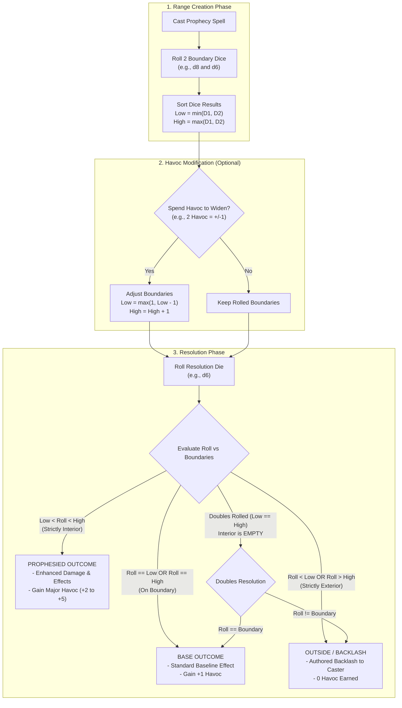
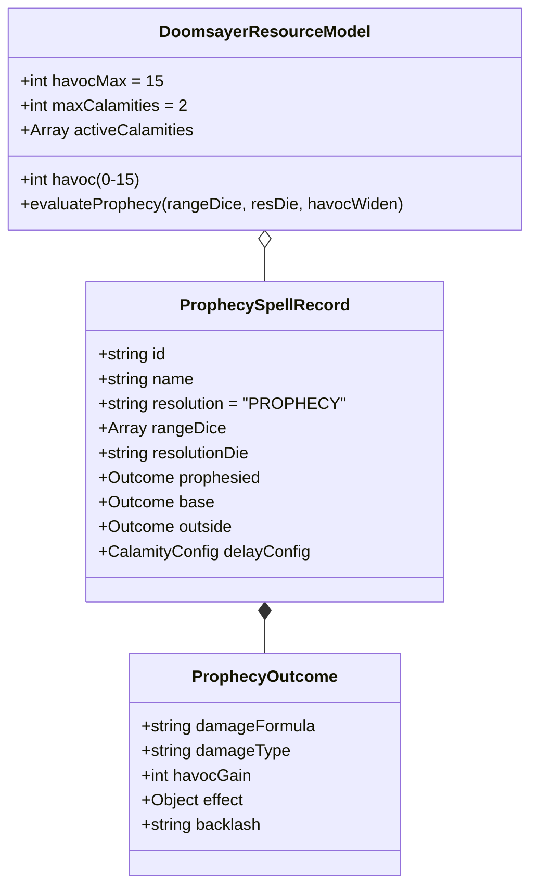

# CLASS HEADQ — DOOMSAYER HISTORICAL IDENTITY AUDIT & RESTORATION CONTRACT
**Status:** Read-only Research, Forensic Discrepancy Analysis, and Proposed Restoration Contract  
**Classification:** Class Architecture Audit (Planning & Design Only — Zero Implementation / Zero Mutations)  
**Date:** 2026-11-03  
**Auditor:** Antigravity (Class HeadQ Forensic Track)  
**Workspace:** `d:\VTT`  
**Current HEAD:** `7e636125` (Tue Nov 3 2026)  
**Pre-Consolidation Snapshot:** `aa54e9df07f1137a48da950a8cd13fda643041e5` (Mon Jun 8 09:25:54 2026 +0200)  
**Consolidation Commit:** `fc0966276431eaa60c675a72df1625061287627e` (Thu Jun 11 22:28:08 2026 +0200)  
**RI-5 Implementation Commit:** `562d958d2b150c48779e7198987c1ae9f8df7f56` (Sun Oct 25 21:32:57 2026 +0100)  

---

## 1. Executive Summary & Forensic Verdict

### 1.1 Core Finding: Identity Substitution
The current working tree representation of the **Doomsayer** (`vtt-react/src/data/classes/doomsayerData.js`, authored during RI-5 in commit `562d958d`) **does not preserve its creator-defined identity**. 

The historical creator-defined Doomsayer is anchored on the **Two-Dice Prophecy System** paired with an entropic **Havoc (0–15)** economy. During the RI-5 consolidation pass, Doomsayer was mistakenly treated as a pure player-facing alias and successor for **Harbinger**'s lore concept. Its entire historical mechanical architecture (two-dice range definition, resolution die comparison, strictly interior "Prophesied" hits, boundary "Base" hits, outside "Backlash", range widening, and living-bomb detonations) was completely stripped. In its place, an invented system called **"Finite Public Calamities"** (`doom-calamities`: max 2 active calamities, 1–3 own-turn clocks, public disruption declarations, and clock-expiry Havoc awards) was introduced.

### 1.2 Verdict on Current Working Tree
1. **Prophecy Resolution Extinction in Class Data:** The active class records (`cr1_doomsayer_*`, 96 records) contain **0%** prophecy range mechanics. Spells such as `cr1_doomsayer_doom_bolt` and `cr1_doomsayer_doom_countdown` borrowed legacy spell names but replaced two-dice RNG boundary resolution with flat damage or pure countdown clocks.
2. **Survival in Peripheral Subsystems:** The historical two-dice prophecy architecture is **not dead** in the repository. It survived intact in:
   - Recovered historical database: `docs/plans/mythrill-class-reconstruction/evidence/historical-definitions.json` (`classes.Doomsayer` & `trees.Doomsayer`).
   - Spellcrafting Wizard UI: `vtt-react/src/components/spellcrafting-wizard/components/steps/ProphecyStep.jsx`, `vtt-react/src/components/spellcrafting-wizard/components/common/ProphecySummary.jsx`, and `vtt-react/src/components/spellcrafting-wizard/components/common/ProphecyRollTable.jsx`.
   - Server Authoring Schema: `server/shared/services/authoredAbility.js` (lines 14–45, which explicitly validate `prophecyOptions`).
3. **Execution Reality:** Neither the RI-5 calamity countdown nor the historical prophecy system is currently executed by the automated combat engine (`spellConsequenceService.js`). All 96 current records are flagged `manual-tabletop`, `authoredOnly: true`, `executionEnabled: false`.
4. **Harbinger Distinction:** Harbinger remains an active legacy class in the codebase (`vtt-react/src/data/classes/harbingerData.js`) utilizing a **Mayhem Gauge (0–100)** with 4 pressure tiers and a d100 Wild Surge table. It is legally isolated by 414 `keep` dispositions in `vtt-react/src/data/classes/harbingerDispositions.js`. Doomsayer must not borrow or merge with Mayhem.
5. **Restoration Mandate:** The historical two-dice prophecy system is **essential and non-negotiable**. The newer calamity countdown system may complement it as a delayed living-bomb tracking container, but **must never replace prophecy resolution**.

---

## 2. Archaeological Provenance & File Identities

```mermaid
flowchart TD
    A["Pre-Consolidation Snapshot aa54e9df<br/>(2026-06-08)<br/>3,852-line doomsayerData.js<br/>2-Dice Prophecy + Havoc 0-15"] -->|Commit fc096627<br/>Class Deprecation Pass| B["Class Removed from Tree<br/>Harbinger Added (Mayhem 0-100)"]
    B -->|Reconstruction RI-5 Commit 562d958d<br/>(2026-10-25)| C["Current Working Tree HEAD<br/>Invented 'Finite Public Calamities'<br/>96 cr1_doomsayer_* Records<br/>Prophecy Mechanics 100% Stripped"]
    A -.->|Preserved in Repository| D["docs/.../historical-definitions.json<br/>Pre-Consolidation Exact Source"]
    A -.->|Preserved in UI Components| E["Spellcrafting Wizard<br/>ProphecyStep.jsx / ProphecySummary.jsx"]
    C -.->|Audit Target| F["CLASS HEADQ Audit<br/>Mandate: Restore 2-Dice Prophecy"]
    D --> F
    E --> F
```

### Exact Revisions, Paths, and File Signatures

| File Path | Role in Repository | Revision / Snapshot | Size / State | Key Mechanical Identifiers |
|---|---|---|---|---|
| `vtt-react/src/data/classes/doomsayerData.js` | Active Class Data | Current HEAD (`7e636125`) | 733 lines / 52,560 B | `doom-calamities`, 96 `cr1_doomsayer_*` records, `manual-tabletop`, no dice boundary fields |
| `vtt-react/src/data/classes/doomsayerData.js` | Historical Class Data | Snapshot `aa54e9df` | 3,852 lines / 140,211 B | `PROPHECY`, 35 `exampleSpells`, 2-dice range, resolution die, Havoc 0–15 |
| `vtt-react/src/data/talentTrees/doomsayer.js` | Active Talent Trees | Current HEAD (`7e636125`) | 166 lines / 54 nodes | 18 `requiem`, 18 `endbringer`, 18 `forewarner`; flat passive text |
| `vtt-react/src/data/talentTrees/doomsayer.js` | Historical Talent Trees | Snapshot `aa54e9df` | 344 lines / 12,279 B | 39 nodes: `requiem` (13), `endbringer` (13), `cataclysm` (13); explicit prophecy riders |
| `docs/plans/mythrill-class-reconstruction/evidence/historical-definitions.json` | Recovered Historical DB | Current HEAD (`7e636125`) | 1.8 MB JSON | Contains exact pre-consolidation `classes.Doomsayer` and `trees.Doomsayer` |
| `vtt-react/src/data/resourceSystems/doomsayerResourceGuide.js` | Active Player HUD Guide | Current HEAD (`7e636125`) | 46 lines / Version 2 | "Finite Public Calamities", 2 max active, 1–3 turn clock, Havoc 0–15 |
| `vtt-react/src/components/hud/DoomsayerResourceDisplay.jsx` | Active HUD Component | Current HEAD (`7e636125`) | 64 lines | Calm bar rendering Calamities (0–2) and Havoc (0–15); read-only |
| `vtt-react/src/components/spellcrafting-wizard/components/steps/ProphecyStep.jsx` | Spell Wizard Engine | Current HEAD (`7e636125`) | 520 lines | Active 2-dice configuration: `rangeDice` (`d4+d4`, `d6+d4`, `d8+d6`), `resolutionDie`, 3-tier outcomes |
| `vtt-react/src/components/spellcrafting-wizard/components/common/ProphecySummary.jsx` | Spell Card UI Component | Current HEAD (`7e636125`) | 230 lines | Renders "Prophesied vs Base vs Outside" resolution tables and roll tables |
| `vtt-react/src/data/classes/harbingerDispositions.js` | Harbinger Isolation | Current HEAD (`7e636125`) | 117 lines | 414 `keep` dispositions preserving legacy Harbinger Mayhem 0–100 mechanics |
| `docs/plans/mythrill-class-reconstruction/implementation/evidence/RI-5-doomsayer-oracle/CONTENT-LOCK.json` | Frozen Lock Archive | Current HEAD (`7e636125`) | 49,090 lines | RI-5 frozen package containing the flawed `cr1_doomsayer_*` records |

---

## 3. Deep Analysis Across the Five Required Perspectives

### Perspective 1: Recovered Historical Evidence
*(Source: Snapshot `aa54e9df07f1137a48da950a8cd13fda643041e5`, `historical-definitions.json`, and pre-consolidation commit history)*

1. **Two-Dice Boundary Generation:**
   - Spells author a pair of boundary dice (`rangeDice: ['d8', 'd6']`, `['d6', 'd4']`, `['d4', 'd4']`, `['d10', 'd8']`, `['d12', 'd10']`).
   - Caster rolls both dice. Results are dynamically sorted: the lower number becomes the **Low Boundary**; the higher number becomes the **High Boundary**. Die face sizes do not dictate position.
2. **Three-Tier Resolution Die Comparison:**
   - A specified resolution die (`resolutionDie: 'd4'`, `'d6'`, `'d8'`, `'d10'`) is rolled (immediately for instant spells, or at countdown conclusion for delayed living bombs).
   - **Prophesied (Interior):** Roll result is strictly greater than Low and strictly less than High ($\text{Low} < \text{Roll} < \text{High}$). Yields enhanced damage/effects and major Havoc generation (+2 to +5 Havoc).
   - **Base (Boundary):** Roll result exactly equals Low or High ($\text{Roll} = \text{Low}$ or $\text{Roll} = \text{High}$). Yields standard baseline effect and +1 Havoc.
   - **Outside / Backlash (Exterior):** Roll result is strictly below Low or strictly above High ($\text{Roll} < \text{Low}$ or $\text{Roll} > \text{High}$). Yields **Prophecy Backlash** (authored negative effect, self-damage, mana drain, or fizzle) and **0 Havoc**.
3. **Strict Doubles Rule:**
   - If both boundary dice roll the same value (e.g. `d4=3` and `d4=3`, Low = 3, High = 3), the interior set is null ($\emptyset$).
   - A Prophesied outcome is mathematically impossible on doubles. The roll can only hit the boundary (Base) or miss entirely (Outside/Backlash).
4. **Range Widening:**
   - Doomsayers spend Havoc to widen fate's window before rolling the resolution die.
   - Text documents spending Havoc to expand boundaries outward (e.g. expanding 4–8 to 3–9 by spending Havoc).
5. **Instant vs Delayed Prophecies (Living Bombs):**
   - **Instant:** Resolved immediately upon casting (e.g., `doomsayer_doom_bolt`).
   - **Delayed (Living Bombs / Countdowns):** Planted on a target with a multi-round duration (e.g., `doomsayer_doom_countdown`, 3 rounds). Deals ticking damage each round (+1 Havoc per tick) and executes the full prophecy resolution roll at duration zero.
6. **Historical Specializations:**
   - **Requiem:** Fatalistic single-target execution. Employs narrow boundary dice (`d4+d4`), Death Marks, bonus damage when range is tight, and Havoc refunds on execution kills.
   - **Endbringer:** Escalating delayed gratification. Delayed prophecies gain +1d6 damage per round and +1 Havoc per tick. Radiates a Doom Aura imposing roll penalties based on Havoc held.
   - **Cataclysm:** Battlefield-wide area chaos. Area prophecies (15–40 ft radius), multi-target RNG resolution, earning +1 Havoc per enemy caught, overlapping doom zones.
7. **Historical Artifact Flaws (To Be Rejected):**
   - **Havoc Overflow Fire:** Overflowing 15 Havoc converted into 1d4 fire damage per excess point hurled at random targets or inward.
   - **Immunity Bypasses:** High-tier talents claiming prophecies "cannot be dispelled or removed early".
   - **Absurd Numbers / Instakills:** Talents granting "20d12 necrotic damage; if below 25% HP, target is reduced to 0".
   - **Extreme Stacking Debuffs:** Doom Aura stacking up to -8 to all enemy d20 rolls.

### Perspective 2: Current Authored Content
*(Source: Current working tree `doomsayerData.js`, `doomsayerResourceGuide.js`, `CONTENT-LOCK.json` under RI-5)*

1. **Complete Eradication of Prophecy Mechanics:**
   - Not a single one of the 96 records in `doomsayerData.js` defines `rangeDice`, `resolutionDie`, `prophesied`, `base`, or `backlash`.
   - The string `PROPHECY` is completely absent from the resolution types. Every damage record specifies flat `resolution: 'DICE'` or `op: 'doom.strike'`.
2. **The Invented "Finite Public Calamities" System:**
   - Resource model redefined as `doom-calamities` with state schema:
     ```json
     {
       "version": 1,
       "type": "doom-calamities",
       "havoc": 0,
       "maxCalamities": 2,
       "calamities": []
     }
     ```
   - Core spells reduced to `cr1_doomsayer_plant_calamity` (allocates 1 of 2 public slots, 1–3 turn clock) and `cr1_doomsayer_dismantle_calamity` (frees slot, 0 Havoc).
   - Havoc economy uncoupled from prophecy fulfillment: Havoc is granted purely via clock events: +3 on trigger resolution, +1 on clock expiry, 0 on dismantle.
3. **Specialization Alteration:**
   - Historical `Cataclysm` (area chaos) was deleted and replaced by `Forewarner` ("The Public Warning"), which focuses on declaring calamities and protecting allies from friendly fire.
4. **Pure Manual-Tabletop Sandbox:**
   - Every single record is tagged: `authoredOnly: true, manualOnly: true, executionEnabled: false, applicationMode: 'manual-tabletop'`.

### Perspective 3: Behavior Actually Executed by Consumers
*(Source: Runtime scan across `vtt-react/src/`, `server/`, stores, and test suites)*

1. **Party HUD & Resource Bar:**
   - `DoomsayerResourceDisplay.jsx` is mounted by `ClassResourceBar.jsx` when `character.class === 'Doomsayer'` or resource type is `doom-calamities`.
   - Renders a clean Calm-styled UI displaying active calamity slots (`0/2`) and Havoc (`0/15`). It is **read-only**: clicking or inspecting it does not advance clocks, allocate Havoc, or roll dice.
2. **Character & Spellbook Stores:**
   - `characterStore.js` / `progressionSlice.js` correctly loads `DOOMSAYER_DATA`, handles level-up choices from `DOOMSAYER_DATA.spellPools` (4 options per level), and tracks talent point allocation across `DOOMSAYER_TREES`.
   - Verified by 18 passing tests in `doomsayerOracleStoreIntegration.test.jsx`.
3. **Automated Combat & Consequence Engine:**
   - `spellConsequenceService.js`, `spellConsequence.js`, and `server/services/spellPayments.js` have **zero automated handlers** for Doomsayer.
   - When a Doomsayer spell is cast, it does not evaluate calamity triggers, does not auto-advance clocks, and does not calculate prophecy outcomes. All adjudication is left to the GM.
4. **Spellcrafting Wizard Active Execution:**
   - In contrast to the combat engine, the Spellcrafting Wizard has an **active, working implementation** of the historical Two-Dice Prophecy System:
     - `ProphecyStep.jsx`: Allows authors to select range dice combinations (`d4+d4`, `d6+d4`, `d6+d6`, `d8+d6`, `d10+d8`, `d12+d10`) and resolution dice (`d4`, `d6`, `d8`, `d10`, `d12`).
     - `ProphecySummary.jsx`: Renders the 3-outcome tier table (Prophesied, Base, Outside/Backlash) with Havoc gain badges and damage formatting.
     - `ProphecyRollTable.jsx`: Renders calamity effect roll tables.
5. **Server Services:**
   - `server/` contains zero references to `doomsayer` or `doom-calamities`.
   - `server/shared/services/authoredAbility.js` explicitly includes `prophecyOptions` in its accepted capability validation schema.

### Perspective 4: Creator-Approved Decisions & Lore Governance
*(Source: Current User Request & Class HeadQ Master Invariants)*

1. **Prophecy Is Non-Negotiable:** The historical two-dice prophecy system is the core identity of the class. Calamity countdown mechanics may remain only as a complement (e.g., tracking ticking living bombs), but must never supplant prophecy resolution.
2. **Doubles Integrity:** Equal boundaries have zero interior; doubles roll Base on match, Outside on non-match. No artificial Prophesied result may be invented for doubles.
3. **Havoc Economy Restraint:** Meaningful loop between fulfilled prophecies generating Havoc, and Havoc being expended on range widening and finishers.
4. **Rejection of Historical Excess:** Historical broken damage numbers, overflow fire damage, dispelling immunity bypasses, and contradictory rules are rejected.
5. **Lore Governance:**
   - **Ancient Practice:** Doomsaying is an ancient practice. Its practitioners unknowingly channel energy from an Old God. The exact deity and cosmic relationship remain deliberately undecided.
   - **Heritage Candidates:** The current approved candidate heritages are **Weft** (strongest candidate), **Riven**, **Cromyx**, and **Bedel**.
   - **Abandoned Heritages:** **Nethien** is formally abandoned.
   - **Unapproved Recommendations:** Earlier suggestions of **Skald**, **Ashen / Anhur**, and **Tessic** are **strictly unapproved**.
   - **Zero Heritage Edge / Bonus:** Doomsayer receives **no native heritage edge, no heritage stat bonuses, and no selector modifications** in the character creator. Pairings remain purely narrative/lore recommendations.

### Perspective 5: Unresolved, Ambiguous, or Conflicting Evidence

1. **Range Widening Formula & Rate:**
   - *Conflict:* Historical text in `doomsayerData.js` (snapshot `aa54e9df`) states in quickOverview: *"Spend Havoc to widen them by +1 per Havoc spent — turning a risky 3–5 into a safe 2–6"*. However, combat examples state: *"Spend 2 Havoc to widen a prophecy range on your next spell by +1 on each boundary"*.
   - *Settlement Required:* Is the exchange 1 Havoc = +1 to both boundaries outward ($\text{Low}-1$, $\text{High}+1$), or 1 Havoc = +1 to a single chosen boundary, or 2 Havoc for a dual expansion?
2. **Third Specialization Selection:**
   - *Conflict:* Historical trees were `Requiem`, `Endbringer`, and `Cataclysm` (Area Chaos). RI-5 replaced `Cataclysm` with `Forewarner` (Public Warning / Ally Protection).
   - *Settlement Required:* Should `Cataclysm` be restored (re-authored with safe, bounded area mechanics), or should `Forewarner` be retained as a defensive prophecy spec, or should `Cataclysm` return with `Forewarner` aspects folded in?
3. **Calamity-Prophecy Integration Topology:**
   - *Conflict:* The prompt states that calamity countdown may complement prophecy resolution.
   - *Settlement Required:* How do the two integrate in the data model?
     - *Topology A (Living Bomb Container):* A Calamity is the formal tracked instance of a delayed prophecy. While active, it ticks and builds Havoc; upon reaching turn 0 or trigger, the resolution die is rolled against the prophecy boundaries.
     - *Topology B (Dual Track):* Doomsayers have 2 Calamity countdown slots for persistent battlefield curses, while instant actions cast direct two-dice prophecies.
4. **Havoc Cap & Overflow Rule:**
   - *Conflict:* Snapshot `aa54e9df` states excess Havoc converts to 1d4 fire damage per point hurled at random targets or self. RI-5 states excess Havoc is quietly discarded.
   - *Settlement Required:* Confirming that overflow is simply lost/capped at 15 without punitive or bonus fire damage, adhering to calm design.
5. **Prophet's Sight Scaling:**
   - *Conflict:* Historical passive gave $+ \lfloor \text{level} / 2 \rfloor$ (up to +5) to all resolution rolls. In a d4 or d6 resolution die, a flat +5 pushes every roll permanently outside the boundary, breaking the RNG math!
   - *Settlement Required:* Rework or replace this passive so it does not distort the interior/boundary probabilities.

---

## 4. Mechanical Audit: The Two-Dice Prophecy System



### 4.1 Boundary Math & Probability Matrix
The mathematical elegance of the historical system lies in the trade-off between dice combinations:

| Boundary Dice | Resolution Die | Range Span | Probability of Doubles (No Interior) | Average Interior Width | Strategic Character |
|---|---|---|---|---|---|
| `d4 + d4` | `d4` | 1–4 | 25.0% ($4/16$) | 0.875 values | Extremely narrow; high backlash risk; massive Prophesied payoff (`Requiem`) |
| `d6 + d4` | `d4` | 1–6 | 16.7% ($4/24$) | 1.417 values | Moderate volatility; biased toward lower values |
| `d6 + d6` | `d6` | 1–6 | 16.7% ($6/36$) | 1.472 values | Standard baseline prophecy curve |
| `d8 + d6` | `d6` | 1–8 | 12.5% ($6/48$) | 2.167 values | Broader range; safer Prophesied landing |
| `d10 + d8` | `d8` | 1–10 | 10.0% ($8/80$) | 2.900 values | Wide area prophecy; consistent Base/Prophesied hits (`Cataclysm`) |
| `d12 + d10` | `d10` | 1–12 | 8.3% ($10/120$) | 3.633 values | Capstone apocalyptic spread |

### 4.2 Handling of Doubles
- If $D_1 = D_2 = k$, then $\text{Low} = k$ and $\text{High} = k$.
- The interior $\{ x \in \mathbb{Z} \mid k < x < k \}$ is **empty** ($\emptyset$).
- **Rule:** If the resolution die rolls $k$, the outcome is **Base**. If it rolls anything other than $k$, the outcome is **Outside/Backlash**. Under no circumstances is a Prophesied outcome generated on doubles.

### 4.3 The Havoc Economy Loop
- **Cap & Persistence:** 0–15 Havoc bank. Persists between encounters within the same adventuring day. Drains to 0 on a completed Long Rest.
- **Generation:**
  - Fulfilled Prophecy (Prophesied outcome): $+2$ to $+5$ Havoc (authored per spell).
  - Boundary Hit (Base outcome): $+1$ Havoc.
  - Miss / Backlash (Outside outcome): $+0$ Havoc.
  - Delayed Living Bomb Ticks: $+1$ Havoc per turn active.
- **Expenditure:**
  - **Range Widening:** Spend Havoc before rolling the resolution die to expand the boundaries outward.
  - **Authored Finishers:** High-tier spells requiring 3 to 15 Havoc to cast (e.g. `Requiem Supreme`, `Cascade Doom`).
  - **Overflow:** Any Havoc earned beyond 15 is discarded (calm tabletop standard; no overflow fire damage).

---

## 5. Lore & Heritage Governance Reconciliation

### 5.1 Lore Origin Correction
- **Old Narrative (Deprecated):** The Skald archivist Malakor the Grim locking himself in the Scribe's Tower of Nordhalla during Sol's Deepening, calculating the dying star via star-arithmetic.
- **Creator Canonical Invariant:**
  - Doomsaying is an **ancient, primordial practice**.
  - Its practitioners **unknowingly channel energy from an Old God**.
  - The exact identity of the deity and their cosmic relationship remain **undecided in canon**.
  - Practitioners perceive their power as inevitable mathematics, entropic certainty, or unraveling threads of fate, completely unaware that their fatalism acts as a siphon for an ancient cosmic patron.

### 5.2 Heritage Alignment & Candidates
- **Current Approved Heritage Candidates:**
  1. **Weft (Strongest Candidate):** The cosmological resonance with fate-threads, unraveling fabric, and ancient pattern-ruptures makes Weft the leading cultural cradle.
  2. **Riven:** Fractured reality and dimensional instability align naturally with entropic collapse.
  3. **Cromyx:** Deep earth, slow grinding pressure, and inevitability.
  4. **Bedel:** Somber liturgical traditions and fatalistic memory.
- **Explicitly Rejected Heritages:**
  - **Nethien:** Formally abandoned.
  - **Skald:** Earlier recommendations rejected (remains with Skald/Nordhalla tradition; not Doomsayer).
  - **Anhur / Ashen:** Earlier recommendations rejected (forge cooling arithmetic belongs to Harbinger/Solari).
  - **Tessic:** Earlier recommendations rejected (belongs to Harbinger pre-planned collapse choreography).
- **Application Constraint:** Doomsayer receives **no registered native heritage edge** (`nativeAccess: []`), **no heritage stat bonuses**, and **no selector modifications** in the character creator. Pairings remain purely narrative/lore recommendations.

---

## 6. Proposed Restoration Contract



### Part A: Settled Technical & Mechanical Requirements
1. **Core Resolution Engine:** All primary Doomsayer attack and debuff actions must specify `resolution: 'PROPHECY'`.
2. **Standard Prophecy Schema:** Every prophecy spell record must author:
   ```js
   mechanicsConfig: [{
     enabled: true,
     system: 'PROPHECY',
     prophecy: {
       rangeDice: ['d8', 'd6'],      // 2 boundary dice
       resolutionDie: 'd6',           // 1 resolution die
       prophesied: {
         damage: '4d8',
         damageType: 'wyrd',
         havocGain: 3,
         effect: { id: 'doom_mark', name: 'Doom I', duration: 2, unit: 'rounds' },
         description: 'Catastrophic fulfillment within boundaries.'
       },
       base: {
         damage: '2d8',
         damageType: 'wyrd',
         havocGain: 1,
         description: 'Direct boundary hit.'
       },
       outside: {
         backlash: '1d6 psychic to self',
         havocGain: 0,
         description: 'Prophecy misses range. The doom turns inward.'
       }
     }
   }]
   ```
3. **Doubles Integrity:** The evaluation engine must strictly enforce: $\text{if } \text{Low} == \text{High}$, then $\text{Prophesied} = \text{false}$.
4. **Calamity Countdown as Complement:** Calamity countdowns (max 2 active) function as the tracking mechanism for **delayed living bombs**. Planting a calamity declares the subject and round clock (1–3 turns). While ticking, it grants $+1$ Havoc per round. When the clock reaches 0, the delayed prophecy detonates by rolling its authored `resolutionDie` against its `rangeDice`.
5. **Havoc Bank Rules:** Integer 0–15. Carries over between combats. Resets to 0 on completed Long Rest. Overflow discarded.

### Part B: Unresolved Creator Decision Points
*(Flagged for Daniel's explicit determination before implementation)*

* **Decision 1: Range Widening Cost & Exchange Rate**
  - *Option A (Symmetric Dual Expansion):* Spend 2 Havoc $\rightarrow$ Low $-1$, High $+1$.
  - *Option B (Single Boundary Nudge):* Spend 1 Havoc $\rightarrow$ move either Low $-1$ OR High $+1$.
  - *Option C (Aggressive Scaling):* Spend 1 Havoc $\rightarrow$ Low $-1$ AND High $+1$ (historical quickOverview text).
  - *Audit Recommendation:* Option A (2 Havoc for $\pm 1$) provides the most balanced risk-reward economy and matches historical play examples.
* **Decision 2: Third Specialization Selection**
  - *Option A (Restore Cataclysm):* Return to `Requiem` (Single Target), `Endbringer` (Escalation/Delay), and `Cataclysm` (Area Chaos), adjusting area spells to modern bounded radius limits (15–20 ft).
  - *Option B (Keep Forewarner):* Keep `Forewarner` as an ally-shielding / public warning support path.
  - *Option C (Cataclysm with Warning Mechanics):* Rename tree to `Cataclysm` but integrate forewarning triggers to prevent party wipe friendly fire.
  - *Audit Recommendation:* Option A or C. Cataclysm is the authentic historical third tree that completes the single-target / delayed / area tri-fold.
* **Decision 3: Old-God Lore Anchor**
  - *Option A:* Explicitly name the Old God in class lore as an ancient primordial entity from the Weft-Weave.
  - *Option B:* Leave the Old God intentionally anonymous in player-facing copy, keeping it as an enigmatic patron known only through aberrant whispers and cold arithmetic.
  - *Audit Recommendation:* Option B preserves cosmic horror mystery and prevents canon collisions.

### Part C: Reusable Shared-Engine Architecture
To ensure clean integration without duplicated logic, three shared components must be leveraged:
1. **Pure Evaluation Helper (`evaluateProphecyResolution.js`):**
   ```js
   export function evaluateProphecyRoll({ lowBoundary, highBoundary, resolutionRoll, havocWiden = 0 }) {
     const effLow = Math.max(1, lowBoundary - havocWiden);
     const effHigh = highBoundary + havocWiden;
     if (effLow === effHigh) {
       return resolutionRoll === effLow ? 'base' : 'outside';
     }
     if (resolutionRoll > effLow && resolutionRoll < effHigh) return 'prophesied';
     if (resolutionRoll === effLow || resolutionRoll === effHigh) return 'base';
     return 'outside';
   }
   ```
2. **Spellcrafting Wizard Alignment:** Update `ProphecyStep.jsx` and `ProphecySummary.jsx` to consume the identical schema and helper.
3. **Calm HUD Bar Integration:** Refactor `DoomsayerResourceDisplay.jsx` to show both the **Havoc Gauge (0–15)** with Range Widening quick-toggles and the **Calamity Countdown Slots (0/2)**.

### Part D: Compatibility, Regression & Migration Risk Register

| Risk ID | System / Component | Severity | Description & Mitigation |
|---|---|---|---|
| **CR-01** | Harbinger Isolation | **HIGH** | Legacy Harbinger (`harbingerData.js`, Mayhem 0–100) must remain completely independent. Ensure `harbingerDispositions.js` retains all 414 keep mappings and no shared resource IDs are introduced. |
| **CR-02** | 37-Class Catalog Tests | **HIGH** | `classCatalogueConsistency.test.js` and `doomsayerIntegration.test.js` test exact spell counts (96 records) and core IDs. Updating IDs without synchronizing test assertions will break CI. |
| **CR-03** | Spellcrafting Wizard Schema | **MEDIUM** | Custom spells created with `PROPHECY` resolution in the wizard must continue to serialize cleanly into character spellbooks. |
| **CR-04** | Character Persistence / Saves | **LOW** | Existing saved characters with Doomsayer have `state: null` or `{ havoc: 0, calamities: [] }`. The restored state schema must gracefully migrate old state by defaulting missing properties without throwing errors. |
| **CR-05** | Guest Presence Parity | **LOW** | Ensure Doomsayer guest sessions accurately synchronize Havoc and active countdowns across P14 guest presence protocols. |

### Part E: Bounded Implementation & Test Handoff Plan
When approved by the creator, implementation should proceed in four strictly bounded slices:

1. **Slice 1: Engine Foundation & Data Contracts**
   - Author `vtt-react/src/utils/prophecyEngine.js` (pure roll evaluation, doubles handling, range widening).
   - Update `classResourceContracts.js` to define the combined `prophecy-calamity` resource contract.
   - Unit tests covering 100% of boundary edge cases (doubles, min/max rolls, widening bounds).
2. **Slice 2: Class Data & Manifest Restoration**
   - Reconstruct `vtt-react/src/data/classes/doomsayerData.js` combining the 35 historical prophecy spells with the 2-calamity complement structure.
   - Reconstruct `vtt-react/src/data/talentTrees/doomsayer.js` restoring the `Requiem`, `Endbringer`, and `Cataclysm` progression trees (54 nodes, 150 ranks).
   - Remove Skald/Anhur/Tessic recommendations; insert Old-God lore with Weft/Riven/Cromyx/Bedel cultural notes.
3. **Slice 3: HUD Display & Resource Guide Alignment**
   - Update `doomsayerResourceGuide.js` to teach the two-dice prophecy system, doubles rule, and Havoc economy alongside calamity clocks.
   - Update `DoomsayerResourceDisplay.jsx` to render Havoc tokens (0–15), range widening indicator, and active calamity timers.
4. **Slice 4: Integration Verification**
   - Update `doomsayerIntegration.test.js` and `doomsayerOracleStoreIntegration.test.jsx`.
   - Verify character creation, level-up choices, and talent resets pass all tests.
   - Record frozen evidence package and clean audit report.

---

## 7. Evidence Audit Manifest & Source Verifications

| Evidence ID | Path | Exact Revision | Checksum / Content Match |
|---|---|---|---|
| `EV-HIST-01` | `docs/plans/mythrill-class-reconstruction/evidence/historical-definitions.json` | `78cab7d0` | Contains historical `classes.Doomsayer` with 35 exampleSpells and 3 trees |
| `EV-SNAP-01` | `vtt-react/src/data/classes/doomsayerData.js` | `aa54e9df` | 3,852 lines; exact 2-dice prophecy rules; Havoc 0–15 |
| `EV-SNAP-02` | `vtt-react/src/data/talentTrees/doomsayer.js` | `aa54e9df` | 344 lines; `DOOMSAYER_REQUIEM`, `DOOMSAYER_ENDBRINGER`, `DOOMSAYER_CATACLYSM` |
| `EV-CURR-01` | `vtt-react/src/data/classes/doomsayerData.js` | `7e636125` | 733 lines; `doom-calamities`; 96 `cr1_doomsayer_*` records |
| `EV-CURR-02` | `vtt-react/src/data/classes/harbingerDispositions.js` | `7e636125` | 117 lines; 414 explicit `keep` records |
| `EV-WIZ-01` | `vtt-react/src/components/spellcrafting-wizard/components/steps/ProphecyStep.jsx` | `7e636125` | Working UI for 2-dice ranges (`d4+d4` to `d12+d10`) |
| `EV-WIZ-02` | `vtt-react/src/components/spellcrafting-wizard/components/common/ProphecySummary.jsx` | `7e636125` | Renders Prophesied / Base / Outside 3-tier card view |
