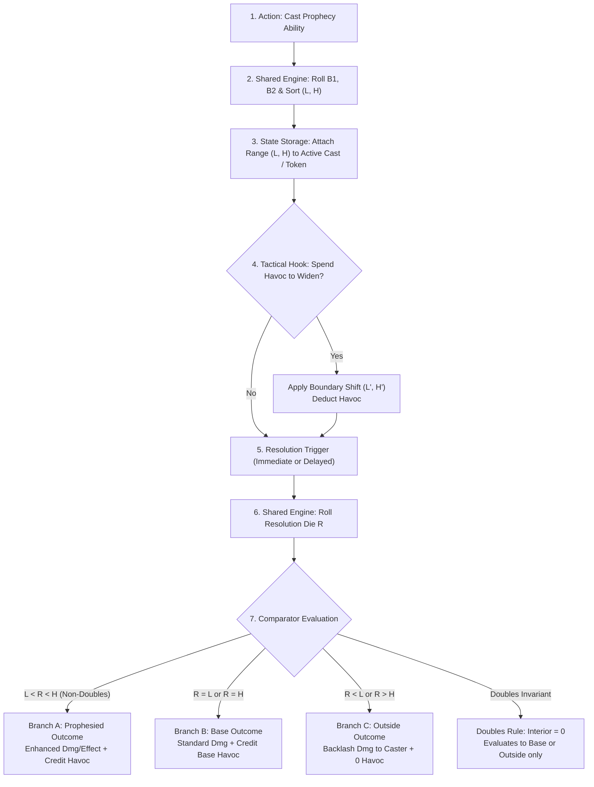

# CLASS HEADQ — DOOMSAYER PROPHECY DESIGN EVALUATION
## Evidence-Led Tabletop Procedure, Discrete Probability Modeling, and Engine Seam Analysis

**Status:** Design Evaluation Report (Read-Only Forensic Assessment & Systems Analysis)  
**Authority:** Class HeadQ Design Auditor  
**Date:** 2026-11-03  
**Workspace:** `d:\VTT`  
**Current HEAD:** `00c4319a915d9025cfc35a122ac28dca516405c9`  
**Target Path:** `docs/plans/mythrill-class-reconstruction/evidence/DOOMSAYER_PROPHECY_DESIGN_EVALUATION.md`  
**Context:** Complements and deepens the cohort findings in [CLASS_HEADQ_RECONCILIATION_AND_IDENTITY_AUDIT_2026-11-03.md](file:///d:/VTT/docs/plans/mythrill-class-reconstruction/evidence/CLASS_HEADQ_RECONCILIATION_AND_IDENTITY_AUDIT_2026-11-03.md).

---

## Executive Summary & Non-Implementation Notice

This document evaluates the defining **two-boundary prophecy procedure** for the Doomsayer class. It is an **evidence-led design evaluation only**. No application code, class definitions, talent trees, spell libraries, test suites, selectors, heritage rules, character saves, or runtime behaviors were modified.

The findings establish that:
1. **Historical Source Verification:** The historical two-boundary prophecy engine existed at pre-consolidation snapshot `aa54e9df07f1137a48da950a8cd13fda643041e5` in `vtt-react/src/data/classes/doomsayerData.js` (blob `d5819dbd6de3f1887ddc58a031dee74d3df925a7`, 3,673 lines) and is compiled in recovery artifact `docs/plans/mythrill-class-reconstruction/evidence/historical-definitions.json` (blob `1bd8c3aec7784e4cec488b3e883548510215ed85`, commit `78cab7d0b711e8f0c6520563da1fb96513e67a1a`).
2. **Current Replacement:** Current authored content (`doomsayerData.js`, RI-5 commit `562d958d`) stripped the two-boundary prophecy dice engine entirely, replacing it with "Finite Public Calamities" (1–3 turn clocks, max 2 active).
3. **Creator Invariant:** The creator requires the historical sorted two-boundary roll procedure and the rule that equal boundaries (natural doubles) have zero interior and never produce a Prophesied outcome.
4. **Baseline Probabilities:** Across the 8 complete historical dice profiles, the baseline probability of rolling a Prophesied outcome without widening ranges from **12.50%** (`d4,d4 vs d4`) to **29.17%** (`d12,d8 vs d8`), while Outside/Backlash ranges from **41.67%** to **57.00%**.
5. **Open Creator Choices:** Range-widening exchange rates, doubles widening behavior, specialization identity (`Cataclysm` vs `Forewarner`), and calamity/prophecy topology remain open decisions requiring creative authority before any implementation contract can be frozen.

---

## Section 1: Verified Historical Procedure and Exact Per-Spell Profiles

### 1.1 The Creator-Approved Invariant Procedure
The roll procedure mandated by the creator follows four discrete phases:

1. **Phase 1: Roll & Sort Boundaries:**  
   The player casts a prophecy spell, rolling two boundary dice specified by the spell: $B_1$ and $B_2$.  
   The results are sorted into:
   $$L = \min(B_1, B_2) \quad (\text{Low Boundary})$$
   $$H = \max(B_1, B_2) \quad (\text{High Boundary})$$
   Die denomination does not determine position—only the numerical face rolled matters.
2. **Phase 2: Optional Widening:**  
   The caster may spend accumulated Havoc to widen the boundary window according to creator-approved exchange rules.
3. **Phase 3: Roll Resolution:**  
   The target or caster rolls the spell's designated resolution die: $R$.
4. **Phase 4: Three-Way Branch Evaluation:**  
   - **Strictly Inside ($L < R < H$):** **Prophesied Outcome** triggers (enhanced spell consequence + spell-specific Havoc gain).
   - **On Boundary ($R = L$ or $R = H$):** **Base Outcome** triggers (standard spell consequence + baseline Havoc gain).
   - **Strictly Outside ($R < L$ or $R > H$):** **Outside / Failure Outcome** triggers (spell-specific Prophecy Backlash, zero Havoc earned).
   - **Doubles Invariant:** If $B_1 = B_2$ ($L = H$, natural doubles), the range possesses zero interior. **Doubles never produce a Prophesied outcome**, including after any widening. The result resolves as Base (if $R = L$) or Outside (if $R \ne L$).

---

### 1.2 Exhaustive Census of Historical Prophecy Spells
Inspection of `historical-definitions.json` (blob `1bd8c3ae...`) and `aa54e9df` `doomsayerData.js` (blob `d5819dbd...`) confirms exactly **20 prophecy spells** (out of 35 total class spells). Every prophecy spell specifies an exact tuple: `rangeDice: [B1, B2]`, `resolutionDie: R`, and distinct `prophesied`, `base`, and `outside` outcome blocks.

The 20 spells group into exactly **8 distinct dice profiles**:

| Profile Index | Range Dice $[B_1, B_2]$ | Resolution Die $R$ | Total Sample Space ($N_{\text{total}}$) | Associated Spells (Count) |
|---|---|---|---|---|
| **P1** | `[d4, d4]` | `d4` | $4 \times 4 \times 4 = 64$ | `doom_whisper` (L1), `death_mark` (L2), `execution_prophecy` (L6), `prophecy_of_annihilation` (L7), `requiem_absolute` (L9) — **5 spells** |
| **P2** | `[d6, d4]` | `d4` | $6 \times 4 \times 4 = 96$ | `omen_of_ash` (L1), `doom_countdown` (L2), `requiem_of_death` (L4) — **3 spells** |
| **P3** | `[d6, d6]` | `d6` | $6 \times 6 \times 6 = 216$ | `omen_flame` (L1), `rain_of_doom` (L3) — **2 spells** |
| **P4** | `[d8, d6]` | `d6` | $8 \times 6 \times 6 = 288$ | `doom_bolt` (L1), `escalating_doom` (L3), `doom_legion` (L8) — **3 spells** |
| **P5** | `[d10, d8]` | `d8` | $10 \times 8 \times 8 = 640$ | `calamity_zone` (L2), `cataclysm_blast` (L4), `cascade_doom` (L6) — **3 spells** |
| **P6** | `[d10, d10]` | `d10` | $10 \times 10 \times 10 = 1000$ | `havoc_blast` (L3) — **1 spell** |
| **P7** | `[d12, d8]` | `d8` | $12 \times 8 \times 8 = 768$ | `prophecy_of_ruin` (L5) — **1 spell** |
| **P8** | `[d12, d10]` | `d10` | $12 \times 10 \times 10 = 1200$ | `doom_nova` (L5), `the_end` (L9) — **2 spells** |

*Structural Invariant in Historical Data:* In all 20 spells, the resolution die denomination matches the second boundary die ($\text{faces}(R) = \text{faces}(B_2)$), and the first boundary die is greater than or equal to the second ($\text{faces}(B_1) \ge \text{faces}(B_2)$).

---

### 1.3 Exact Per-Spell Outcome & Havoc Field Manifest

Below is the verified record of all 20 spells from `historical-definitions.json`:

#### Profile 1: `[d4, d4] vs d4` (High Risk / Single Target Requiem Lineage)
1. **`doomsayer_doom_whisper`** (Level 1, Requiem)
   - *resourceCost:* `mana: 6`, `classResource: { type: "havoc", cost: -2 }`
   - *Prophesied:* Damage `2d6 psychic`, Effect `Doom II` (-2 Spirit saves, 2 rounds), Havoc Gain `+2`
   - *Base:* Damage `1d6 psychic`, Havoc Gain `+1`
   - *Outside:* Backlash `1d4 psychic to self`, Havoc Gain `0`
2. **`doomsayer_death_mark`** (Level 2, Requiem)
   - *resourceCost:* `mana: 10`, `classResource: { type: "havoc", cost: 1 }`
   - *Prophesied:* Damage `6d8 necrotic`, Effect `Marked for Death` (bonus necrotic on hit), Havoc Gain `0`
   - *Base:* Damage `3d8 necrotic`, Havoc Gain `0`
   - *Outside:* Backlash `2d8 necrotic to self + Doom I`, Havoc Gain `0`
3. **`doomsayer_execution_prophecy`** (Level 6, Requiem)
   - *resourceCost:* `mana: 25`, `classResource: { type: "havoc", cost: 8 }`
   - *Prophesied:* Damage `instant_death` (if target below 25% HP, else 12d10 necrotic), Effect `Execution`, Havoc Gain `+10`
   - *Base:* Damage `8d10 necrotic`, Havoc Gain `+5`
   - *Outside:* Backlash `8d10 necrotic to self`, Havoc Gain `0`
4. **`doomsayer_prophecy_of_annihilation`** (Level 7, Requiem)
   - *resourceCost:* `mana: 30`, `classResource: { type: "havoc", cost: 10 }`
   - *Prophesied:* Damage `12d12 necrotic`, Effect `Erasure` (body disintegrated), Havoc Gain `+10`
   - *Base:* Damage `8d12 necrotic`, Havoc Gain `+5`
   - *Outside:* Backlash `6d12 necrotic to self`, Havoc Gain `0`
5. **`doomsayer_requiem_absolute`** (Level 9, Requiem)
   - *resourceCost:* `mana: 45`, `classResource: { type: "havoc", cost: 12 }`
   - *Prophesied:* Damage `instant_death` (if below 50% HP, else 20d12 necrotic), Effect `Absolute Requiem`, Havoc Gain `+12`
   - *Base:* Damage `15d12 necrotic`, Havoc Gain `+6`
   - *Outside:* Backlash `15d12 necrotic to self`, Havoc Gain `0`

#### Profile 2: `[d6, d4] vs d4` (Escalating Countdown Lineage)
6. **`doomsayer_omen_of_ash`** (Level 1, Endbringer)
   - *resourceCost:* `mana: 6`, `classResource: { type: "havoc", cost: -2 }`
   - *Prophesied:* Damage `2d6 necrotic`, Effect `Creeping Doom` (1d6 per round, 3 rounds), Havoc Gain `+2`
   - *Base:* Damage `1d6 necrotic`, Havoc Gain `+1`
   - *Outside:* Backlash `1d4 psychic to self`, Havoc Gain `0`
7. **`doomsayer_doom_countdown`** (Level 2, Endbringer)
   - *resourceCost:* `mana: 10`, `classResource: { type: "havoc", cost: -3 }`
   - *Prophesied:* Damage `4d8 necrotic`, Effect `Doom I`, Havoc Gain `+3`
   - *Base:* Damage `2d8 necrotic`, Havoc Gain `+1`
   - *Outside:* Backlash `1d8 necrotic to self`, Havoc Gain `0`
8. **`doomsayer_requiem_of_death`** (Level 4, Requiem)
   - *resourceCost:* `mana: 16`, `classResource: { type: "havoc", cost: 4 }`
   - *Prophesied:* Damage `8d10 necrotic`, Effect `Soul Wound` (no healing for 2 rounds), Havoc Gain `+6`
   - *Base:* Damage `5d10 necrotic`, Havoc Gain `+3`
   - *Outside:* Backlash `3d10 necrotic to self + Doom II`, Havoc Gain `0`

#### Profile 3: `[d6, d6] vs d6` (Cataclysm Burning / Table-Driven Lineage)
9. **`doomsayer_omen_flame`** (Level 1, Cataclysm)
   - *resourceCost:* `mana: 6`, `classResource: { type: "havoc", cost: -2 }`
   - *Prophesied:* Damage `3d6 fire + 1d6 force`, Effect `Ignited` (1d4 fire per round, 2 rounds), Havoc Gain `+2`
   - *Base:* Damage `2d6 fire`, Havoc Gain `+1`
   - *Outside:* Backlash `1d4 fire to self`, Havoc Gain `0`
10. **`doomsayer_rain_of_doom`** (Level 3, Cataclysm)
    - *resourceCost:* `mana: 14`, `classResource: { type: "havoc", cost: 3 }`
    - *Prophesied:* Damage `null` (condition table), Effect `Double Rain` (roll twice on Rain Table), Havoc Gain `+4`
    - *Base:* Damage `null`, Effect `Single Rain` (roll once on Rain Table), Havoc Gain `+2`
    - *Outside:* Backlash `Self Rain` (caster rolls on Rain Table against self), Havoc Gain `0`

#### Profile 4: `[d8, d6] vs d6` (Core Universal / Escalating Lineage)
11. **`doomsayer_doom_bolt`** (Level 1, Universal)
    - *resourceCost:* `mana: 6`, `classResource: { type: "havoc", cost: -3 }`
    - *Prophesied:* Damage `4d8 necrotic`, Effect `Doom I`, Havoc Gain `+3`
    - *Base:* Damage `2d8 necrotic`, Havoc Gain `+1`
    - *Outside:* Backlash `1d8 psychic to self`, Havoc Gain `0`
12. **`doomsayer_escalating_doom`** (Level 3, Endbringer)
    - *resourceCost:* `mana: 12`, `classResource: { type: "havoc", cost: -2 }`
    - *Prophesied:* Damage `4d10 force`, Effect `Doom II`, Havoc Gain `+5`
    - *Base:* Damage `2d10 force`, Havoc Gain `+2`
    - *Outside:* Backlash `1d10 force to self`, Havoc Gain `0`
13. **`doomsayer_doom_legion`** (Level 8, Cataclysm)
    - *resourceCost:* `mana: 35`, `classResource: { type: "havoc", cost: 10 }`
    - *Prophesied:* Damage `8d8 mixed`, Effect `Legion Ignition` (chains across targets), Havoc Gain `+4`
    - *Base:* Damage `5d8 mixed`, Havoc Gain `+2`
    - *Outside:* Backlash `2d8 per target in range to self`, Havoc Gain `0`

#### Profile 5: `[d10, d8] vs d8` (Cataclysm Area Blast Lineage)
14. **`doomsayer_calamity_zone`** (Level 2, Cataclysm)
    - *resourceCost:* `mana: 10`, `classResource: { type: "havoc", cost: -4 }`
    - *Prophesied:* Damage `3d8 fire + 1d8 force`, Effect `Burning Ground`, Havoc Gain `+4`
    - *Base:* Damage `2d8 fire`, Havoc Gain `+2`
    - *Outside:* Backlash `1d6 fire to self`, Havoc Gain `0`
15. **`doomsayer_cataclysm_blast`** (Level 4, Cataclysm)
    - *resourceCost:* `mana: 18`, `classResource: { type: "havoc", cost: 4 }`
    - *Prophesied:* Damage `6d8 fire + 3d8 necrotic`, Effect `Difficult Terrain`, Havoc Gain `+6`
    - *Base:* Damage `4d8 fire + 2d8 necrotic`, Havoc Gain `+3`
    - *Outside:* Backlash `2d8 to self + Doom I`, Havoc Gain `0`
16. **`doomsayer_cascade_doom`** (Level 6, Cataclysm)
    - *resourceCost:* `mana: 25`, `classResource: { type: "havoc", cost: 7 }`
    - *Prophesied:* Damage `8d8 fire`, Effect `Cascade Detonation` (adjacent enemies take half), Havoc Gain `+8`
    - *Base:* Damage `5d8 fire`, Havoc Gain `+4`
    - *Outside:* Backlash `3d8 fire to self`, Havoc Gain `0`

#### Profile 6: `[d10, d10] vs d10` (Direct Havoc Conversion)
17. **`doomsayer_havoc_blast`** (Level 3, Universal)
    - *resourceCost:* `mana: 12`, `classResource: { type: "havoc", cost: 3 }`
    - *Prophesied:* Damage `5d10 force`, Effect `none`, Havoc Gain `0`
    - *Base:* Damage `3d10 force`, Havoc Gain `0`
    - *Outside:* Backlash `2d10 force to self`, Havoc Gain `0`

#### Profile 7: `[d12, d8] vs d8` (Wide Ruin Lineage)
18. **`doomsayer_prophecy_of_ruin`** (Level 5, Universal)
    - *resourceCost:* `mana: 20`, `classResource: { type: "havoc", cost: 5 }`
    - *Prophesied:* Damage `8d8 mixed`, Effect `Doom III` (-3 Spirit saves, 3 rounds), Havoc Gain `+8`
    - *Base:* Damage `5d8 mixed`, Havoc Gain `+4`
    - *Outside:* Backlash `3d8 to self + Doom II`, Havoc Gain `0`

#### Profile 8: `[d12, d10] vs d10` (Ultimate End Lineage)
19. **`doomsayer_doom_nova`** (Level 5, Cataclysm)
    - *resourceCost:* `mana: 22`, `classResource: { type: "havoc", cost: 6 }`
    - *Prophesied:* Damage `6d8 fire + 6d8 necrotic`, Effect `Ignited`, Havoc Gain `+8`
    - *Base:* Damage `4d8 fire + 4d8 necrotic`, Havoc Gain `+4`
    - *Outside:* Backlash `2d8 fire + 2d8 necrotic to self`, Havoc Gain `0`
20. **`doomsayer_the_end`** (Level 9, Universal)
    - *resourceCost:* `mana: 45`, `classResource: { type: "havoc", cost: 12 }`
    - *Prophesied:* Damage `10d10 mixed`, Effect `Erasure`, Havoc Gain `+12`
    - *Base:* Damage `6d10 mixed`, Havoc Gain `+6`
    - *Outside:* Backlash `4d10 to self`, Havoc Gain `0`

---

## Section 2: Mathematical Probability Analysis & Baseline Outcome Table

### 2.1 Discrete Enumeration Methodology
For each profile with boundary dice faces $N_1, N_2$ and resolution die faces $N_R$, the exact state space consists of $N_{\text{total}} = N_1 \times N_2 \times N_R$ equally probable discrete outcomes.

Each outcome is generated by the triple $(b_1, b_2, r)$ where $b_1 \in [1, N_1], b_2 \in [1, N_2], r \in [1, N_R]$.
- Sorted boundaries: $L = \min(b_1, b_2)$, $H = \max(b_1, b_2)$.
- If $b_1 = b_2$ (natural doubles):
  - Interior is strictly empty ($\emptyset$).
  - **Prophesied Count:** $0$ (creator requirement).
  - If $r = L$: **Base Count** $+1$.
  - If $r \ne L$: **Outside Count** $+1$.
- If $b_1 \ne b_2$:
  - If $L < r < H$: **Prophesied Count** $+1$.
  - If $r = L$ or $r = H$: **Base Count** $+1$.
  - If $r < L$ or $r > H$: **Outside Count** $+1$.

---

### 2.2 Baseline Outcome Probability Table

| Profile $[B_1, B_2] \text{ vs } R$ | Total States ($N_{\text{total}}$) | Prophesied ($L < R < H$) | Base ($R = L \lor R = H$) | Outside ($R < L \lor R > H$) | Doubles Total (Base / Outside) |
|---|---|---|---|---|---|
| **`[d4, d4] vs d4`** | 64 | **8** (1/8, **12.50%**) | **28** (7/16, **43.75%**) | **28** (7/16, **43.75%**) | 16 (4 Base, 12 Outside) |
| **`[d6, d4] vs d4`** | 96 | **20** (5/24, **20.83%**) | **36** (3/8, **37.50%**) | **40** (5/12, **41.67%**) | 16 (4 Base, 12 Outside) |
| **`[d6, d6] vs d6`** | 216 | **40** (5/27, **18.52%**) | **66** (11/36, **30.56%**) | **110** (55/108, **50.93%**) | 36 (6 Base, 30 Outside) |
| **`[d8, d6] vs d6`** | 288 | **70** (35/144, **24.31%**) | **78** (13/48, **27.08%**) | **140** (35/72, **48.61%**) | 36 (6 Base, 30 Outside) |
| **`[d10, d8] vs d8`** | 640 | **168** (21/80, **26.25%**) | **136** (17/80, **21.25%**) | **336** (21/40, **52.50%**) | 64 (8 Base, 56 Outside) |
| **`[d10, d10] vs d10`** | 1000 | **240** (6/25, **24.00%**) | **190** (19/100, **19.00%**) | **570** (57/100, **57.00%**) | 100 (10 Base, 90 Outside) |
| **`[d12, d8] vs d8`** | 768 | **224** (7/24, **29.17%**) | **152** (19/96, **19.79%**) | **392** (49/96, **51.04%**) | 64 (8 Base, 56 Outside) |
| **`[d12, d10] vs d10`** | 1200 | **330** (11/40, **27.50%**) | **210** (7/40, **17.50%**) | **660** (11/20, **55.00%**) | 100 (10 Base, 90 Outside) |

---

### 2.3 Mathematical Observations on Baseline Probabilities
1. **Symmetric Dice Suffer Low Prophesied Rates:**  
   Profiles using identical boundary dice (`d4,d4`, `d6,d6`, `d10,d10`) suffer heavy doubles frequency ($1/N_1 = 25\%$ in `d4`, $16.7\%$ in `d6`, $10\%$ in `d10`). Combined with adjacent rolls ($|B_1 - B_2| = 1$), `d4,d4 vs d4` produces an interior in only 6 out of 16 boundary rolls, yielding an overall Prophesied rate of just **12.50%**.
2. **Asymmetric Dice Naturally Widen Interior:**  
   Profiles pairing a larger first die with a smaller second die (`d6,d4`, `d8,d6`, `d10,d8`, `d12,d8`) reduce doubles frequency and introduce high-spread rolls ($B_1 > N_2$). In `d12,d8 vs d8`, when $B_1 \ge 8$, the high boundary frequently caps at the maximum resolution die face, lifting the baseline Prophesied rate to **29.17%**.
3. **Outside / Backlash is the Dominant Baseline State:**  
   In 6 out of 8 profiles, Outside is the absolute majority outcome ($\ge 48.61\%$). In `d10,d10 vs d10`, Backlash occurs on **57.00%** of unwidened casts. This confirms the narrative identity of the Doomsayer as a volatile, dangerous class where casting without Havoc widening carries severe personal risk.

---

## Section 3: Candidate Range-Widening Models & Doubles Evaluation

### 3.1 Candidate Widening Definitions (Without Selecting a Rule)
Two distinct mathematical candidate operations can be modeled:

- **Candidate Operation A (Symmetric Widening):**  
  Each widening step expands the boundaries outward in both directions by 1 result step:
  $$L' = \max(1, L - 1), \quad H' = \min(N_R, H + 1)$$
- **Candidate Operation B (Single-Boundary Widening):**  
  Each widening step expands either $L$ downward by 1 OR $H$ upward by 1, chosen by the caster:
  $$\text{Player chooses: } L' = \max(1, L - 1) \text{ OR } H' = \min(N_R, H + 1)$$

---

### 3.2 Evaluation of Natural Doubles Under Widening
The creator requires that natural doubles have zero interior and **never produce a Prophesied outcome**, even after widening. Two candidate rules are evaluated for how widening interacts with doubles:

- **Doubles Policy 1 (Widening Unavailable on Doubles):**  
  If $B_1 = B_2$, widening is disabled entirely. The roll must resolve strictly at its original single boundary value (Base on $R = L$, Outside on $R \ne L$).
- **Doubles Policy 2 (Base Safety Net Expansion):**  
  Widening is permitted on doubles, but **can only expand the Base outcome landing zone**.  
  For example, if $B_1 = B_2 = 3$, widening by 1 step sets the Base landing zone to $\{2, 3, 4\}$. If $R \in \{2, 3, 4\}$, it resolves as **Base**; otherwise Outside. **Prophesied remains strictly 0.**

---

### 3.3 Probability Effect of Candidate Operation A (Symmetric Widening by 1 Step)

The table below contrasts the baseline unwidened distribution against Candidate Operation A under both Doubles Policy 1 and Doubles Policy 2:

| Profile $[B_1, B_2] \text{ vs } R$ | Baseline Distribution (P / B / O) | Widened: Policy 1 (Doubles Off) (P / B / O) | Widened: Policy 2 (Doubles Base) (P / B / O) | Shift in Prophesied ($\Delta P$) | Shift in Outside ($\Delta O$, Policy 1) |
|---|---|---|---|---|---|
| **`[d4, d4] vs d4`** | 12.5% / 43.8% / 43.8% | **31.3%** / 43.8% / 25.0% | **31.3%** / 53.1% / 15.6% | **+18.8%** | **-18.8%** |
| **`[d6, d4] vs d4`** | 20.8% / 37.5% / 41.7% | **31.3%** / 45.8% / 22.9% | **31.3%** / 52.1% / 16.7% | **+10.5%** | **-18.8%** |
| **`[d6, d6] vs d6`** | 18.5% / 30.6% / 50.9% | **37.0%** / 30.6% / 32.4% | **37.0%** / 35.2% / 27.8% | **+18.5%** | **-18.5%** |
| **`[d8, d6] vs d6`** | 24.3% / 27.1% / 48.6% | **37.5%** / 31.3% / 31.3% | **37.5%** / 34.7% / 27.8% | **+13.2%** | **-17.3%** |
| **`[d10, d8] vs d8`** | 26.3% / 21.3% / 52.5% | **39.1%** / 23.8% / 37.2% | **39.1%** / 25.9% / 35.0% | **+12.8%** | **-15.3%** |
| **`[d10, d10] vs d10`** | 24.0% / 19.0% / 57.0% | **38.4%** / 19.0% / 42.6% | **38.4%** / 20.8% / 40.8% | **+14.4%** | **-14.4%** |
| **`[d12, d8] vs d8`** | 29.2% / 19.8% / 51.0% | **39.6%** / 24.0% / 36.5% | **39.6%** / 25.8% / 34.6% | **+10.4%** | **-14.5%** |
| **`[d12, d10] vs d10`** | 27.5% / 17.5% / 55.0% | **39.3%** / 19.2% / 41.5% | **39.3%** / 20.7% / 40.0% | **+11.8%** | **-13.5%** |

#### Key Inferences:
- Symmetric widening by 1 step boosts Prophesied probability by **+10.4% to +18.8%** across all profiles, bringing fulfillment rates up to **31.3%–39.6%**.
- Backlash risk (Outside) drops dramatically (e.g. from 50.9% to 32.4% on `d6,d6`).
- Under Policy 2, doubles players can still spend Havoc defensively to protect themselves against Backlash (expanding Base to 53.1% on `d4,d4`), without ever opening an interior or creating a Prophesied outcome.

---

## Section 4: Sourced Havoc Economy Analysis

### 4.1 Historical Havoc Generation Patterns
In `historical-definitions.json`, Havoc generation is strictly outcome-driven:
- **Prophesied Gain:** Ranges from **+2 to +12 Havoc**:
  - Minor spells (Level 1): `+2` to `+3` (`doom_whisper` +2, `omen_flame` +2, `omen_of_ash` +2, `doom_bolt` +3)
  - Mid spells (Levels 2–4): `+3` to `+6` (`doom_countdown` +3, `calamity_zone` +4, `escalating_doom` +5, `requiem_of_death` +6, `cataclysm_blast` +6)
  - Major spells (Levels 5–6): `+8` to `+10` (`prophecy_of_ruin` +8, `doom_nova` +8, `cascade_doom` +8, `execution_prophecy` +10)
  - Ultimate spells (Levels 7–9): `+10` to `+12` (`prophecy_of_annihilation` +10, `the_end` +12, `requiem_absolute` +12)
- **Base Gain:** Ranges from **+1 to +6 Havoc** (uniformly configured as approximately half of the Prophesied gain).
- **Outside Gain:** Uniformly **0 Havoc** across all 20 spells.
- **Anomalies:** Two spells grant 0 Havoc on all outcomes: `doomsayer_death_mark` (Level 2) and `doomsayer_havoc_blast` (Level 3).

---

### 4.2 Historical Havoc Expenditure Patterns
Havoc is spent on two distinct categories of actions in the historical draft:
1. **Direct Ability Costs:**  
   13 spells specify a positive Havoc cost in `resourceCost.classResource.cost`:
   - 2 mid-tier single-target spells: `death_mark` (1 Havoc), `havoc_blast` (3 Havoc)
   - 11 high-tier spells (Levels 3–10):
     - Level 3: `rain_of_doom` (3 Havoc)
     - Level 4: `requiem_of_death` (4 Havoc), `cataclysm_blast` (4 Havoc), `doom_aura` (3 Havoc)
     - Level 5: `prophecy_of_ruin` (5 Havoc), `doom_nova` (6 Havoc), `stacked_doom` (6 Havoc)
     - Level 6: `cascade_doom` (7 Havoc), `execution_prophecy` (8 Havoc), `endbringer_finale` (8 Havoc)
     - Level 7: `prophecy_of_annihilation` (10 Havoc), `armageddon_herald` (8 Havoc), `apocalypse_zone` (10 Havoc)
     - Level 8: `doom_legion` (10 Havoc), `twist_of_doom` (5 Havoc), `death_sentence` (10 Havoc)
     - Level 9: `the_end` (12 Havoc), `requiem_absolute` (12 Havoc), `cataclysm_incarnate` (12 Havoc)
     - Level 10 Capstones: `herald_of_the_end` (15 Havoc), `end_of_all_things` (15 Havoc), `final_requiem` (15 Havoc)
2. **Tactical Range Widening:**  
   Prose in `usage.flourish` and `strategicConsiderations` describes spending Havoc to widen boundary dice:
   - *"Spend Havoc to widen them by +1 per Havoc spent—turning a risky 3-5 into a safe 2-6."*
   - *"Each point of Havoc spent widens the range by 1 in each direction... This is often the most efficient use of early Havoc."*

---

### 4.3 Historical Cap, Persistence, and Overflow Rules
In `historical-definitions.json`:
- **Cap:** 15 Havoc (`[HISTORICAL DRAFT]`; historical evidence, not an approved final rule).
- **Persistence:** Carries over between combats; resets to 0 on a long rest.
- **Overflow Rule:** Excess Havoc earned beyond the cap of 15 does not vanish; it converts into **1d4 fire damage per point of overflow** hurled at a random enemy within 30 ft (or burns inward if no enemies are present).

---

## Section 5: Current Implementation Comparison & Verification Boundaries

### 5.1 Repository File Baseline

| Component / Layer | File Path | Current Working Tree State | Verification / Consumer Scope |
|---|---|---|---|
| **Class Data** | `vtt-react/src/data/classes/doomsayerData.js` (734 lines) | 96 `cr1_doomsayer_*` records. **0 prophecy dice.** Replaced with `doom-calamities` (clocks 1–3, max 2 active). | `[TEST COVERAGE]` Schema & level-pruning in `doomsayerIntegration.test.js` |
| **Resource Guide** | `vtt-react/src/data/resourceSystems/doomsayerResourceGuide.js` (47 lines) | Documents "Finite Public Calamities" only. No dice boundary documentation. | Referenced in `resourceSystems/index.js` |
| **Talent Trees** | `vtt-react/src/data/talentTrees/doomsayer.js` (167 lines) | 3 trees (`Requiem`, `Endbringer`, `Forewarner`), 54 nodes. All actives revolve around public calamity clocks. | Validated in `doomsayerIntegration.test.js` |
| **HUD Widget** | `vtt-react/src/components/hud/DoomsayerResourceDisplay.jsx` | Renders Calamities & Havoc tracker (max 2 calamities, clock countdowns, 0–15 Havoc). No dice inputs. | Verified in `DoomsayerOracleResourceDisplay.test.jsx` |
| **Test Suite** | `vtt-react/src/data/classes/__tests__/doomsayerIntegration.test.js` | Validates calamity rules: max 2 calamities, clocks 1–3, Havoc 0–15, 96 records. | `[TEST COVERAGE]` Passes on Jest CLI; does not test prophecy dice. |
| **Spellcrafting Wizard** | `vtt-react/src/components/spellcrafting-wizard/components/steps/ProphecyStep.jsx` (583 lines) | Preserves full UI authoring schema for 2 range dice + 1 resolution die + Havoc gains per tier. | Isolated to Spellcrafting Wizard UI flow. |
| **Server Validation** | `server/shared/services/authoredAbility.js:14–45` | Server-side validation schema recognizes `prophecyOptions` and outcome blocks. | Schema field registration only; no live execution pipeline. |

---

## Section 6: Historical Conflicts, Ambiguities, and Mechanical Discrepancies

Forensic analysis of the historical sources reveals four major mechanical discrepancies:

1. **Static Negative Resource Cost vs. Variable Outcome Gains:**  
   In Level 1–3 spells in `historical-definitions.json` (e.g. `doom_bolt`, `doom_whisper`, `omen_flame`), the top-level field `resourceCost.classResource.cost` specifies a negative number (e.g. `-3`), implying an upfront Havoc grant upon casting. However, the nested `prophecy` block specifies variable gains (`+3` on Prophesied, `+1` on Base, `0` on Outside).  
   *Assessment:* The negative static cost was an early placeholder; the outcome-dependent gain in the prophecy block represents the intended mechanic.
2. **Ambiguity in Widening Exchange Rate (Single vs. Dual Boundary):**  
   In `usage.flourish`, text states *"Spend Havoc to widen them by +1 per Havoc spent—turning a risky 3-5 into a safe 2-6."*  
   Turning `3-5` into `2-6` requires widening **both** boundaries by 1 step (expanding the interior from $\{4\}$ to $\{3, 4, 5\}$). In `strategicConsiderations`, text reiterates *"widens the range by 1 in each direction"*. However, no formal data table or cost schedule exists in code. Whether 1 Havoc expands one boundary or both boundaries remains an open design choice.
3. **Doubles Widening Status:**  
   The historical text states: *"Doubles Rule: If both dice roll the same number... Prophesied is impossible on doubles."*  
   However, neither the historical files nor current code specifies whether a player can spend Havoc on doubles to widen the Base landing zone (Doubles Policy 2), or if widening is strictly disabled on doubles (Doubles Policy 1).
4. **Third Specialization Divergence:**  
   In `aa54e9df` and `historical-definitions.json`, the third specialization is **Cataclysm** (focused on area fire/force ruin and multi-target Havoc generation). In RI-5 (`doomsayerData.js`), the third specialization is **Forewarner** (focused on public defensive wards and ally warning).

---

## Section 7: Creator Decision Register (Strategic Choices Required Before Contract Freeze)

The following items are the **strategic creator choices** that must be settled by creator authority before an implementation contract can be authored:

### Decision 1: Specialization Identity and Calamity Topology
- **Settled Baseline:** Two-boundary prophecy engine ($B_1, B_2$ sorted; $L < R < H$ Prophesied, doubles never Prophesied) is mandatory. `Requiem` (single-target execution) and `Endbringer` (escalating doom) are established.
- **Open Choice for Creator:**
  - Settle the 3rd specialization: restore historical `Cataclysm` (area chaos), retain RI-5 `Forewarner` (ally defense/warning), or author a hybrid.
  - Settle the relationship between delayed calamities and prophecy: do public calamities act as time-delayed containers that resolve via prophecy boundary dice upon detonation, or do they operate on an independent parallel track?

### Decision 2: Natural Doubles Widening Policy
- **Settled Baseline:** Natural doubles possess zero interior and can never produce a Prophesied outcome.
- **Open Choice for Creator:**
  - **Policy 1:** Widening is completely disabled on natural doubles (the roll is frozen as a single value).
  - **Policy 2:** Widening is permitted on natural doubles, but can only expand the Base outcome landing zone (reducing Backlash risk without creating an interior).

### Decision 3: Range-Widening Exchange Rate
- **Settled Baseline:** Havoc is earned from fulfilled prophecies and spent to widen ranges.
- **Open Choice for Creator:**
  - **Model A (Dual-Boundary Expansion):** 1 Havoc expands both boundaries ($L - 1$ and $H + 1$).
  - **Model B (Single-Boundary Step):** 1 Havoc expands one chosen boundary by 1 step ($L - 1$ or $H + 1$).
  - **Model C (Tiered / Denomination-Scaled):** Havoc cost scales with the denomination of the resolution die.

### Decision 4: Havoc Resource Scale & Overflow Behavior
- **Settled Baseline:** Havoc is an entropic resource generated by prophecy fulfillment and lost on long rest.
- **Open Choice for Creator:**
  - Formalize whether to retain the historical 0–15 scale or adopt a tighter tabletop pool (e.g. 0–10).
  - Formalize whether excess Havoc beyond the cap triggers the historical 1d4 fire overflow damage rule or simply caps cleanly.

---

## Section 8: Shared-Engine Dependencies for Mythrill HeadQ

To implement the Doomsayer prophecy procedure without building a fragile, bespoke side-engine, the shared Mythrill combat and ability runtime must provide the following standard engine capabilities:

### Required Shared-Engine Capabilities:
1. **Multi-Stage Roll & State Storage:**  
   Ability for a spell execution pipeline to roll boundary dice, sort them, and persist the tuple $(L, H)$ on an active cast state or target token without immediately resolving the effect.
2. **Delayed Resolution Seam:**  
   Ability for a spell's final resolution to be triggered asynchronously (e.g. at the start/end of a turn, on target action, or after delayed countdown ticks).
3. **Generic Boundary Comparator:**  
   A standardized mathematical comparator that accepts $(L, H, R, \text{doublesFlag})$ and outputs the outcome branch (`PROPHESIED`, `BASE`, `OUTSIDE`) enforcing the strict-interior and doubles invariants.
4. **Multi-Branch Consequence Resolution:**  
   Runtime execution that maps the evaluated branch to distinct payload actions: applying target damage/effects on Prophesied/Base, or applying caster backlash on Outside.
5. **Dynamic Resource Hook:**  
   Post-resolution event listener that credits class resources based on outcome branches (e.g. crediting Havoc on Prophesied/Base, deducting on cast/widening).

---

## Compliance & Non-Implementation Attestation
- **No application files, class data files, tests, selectors, saves, migrations, or runtime behaviors were modified during this evaluation.**
- **Concurrent work on branch `master` at commit `00c4319a915d9025cfc35a122ac28dca516405c9` remains fully preserved.**
